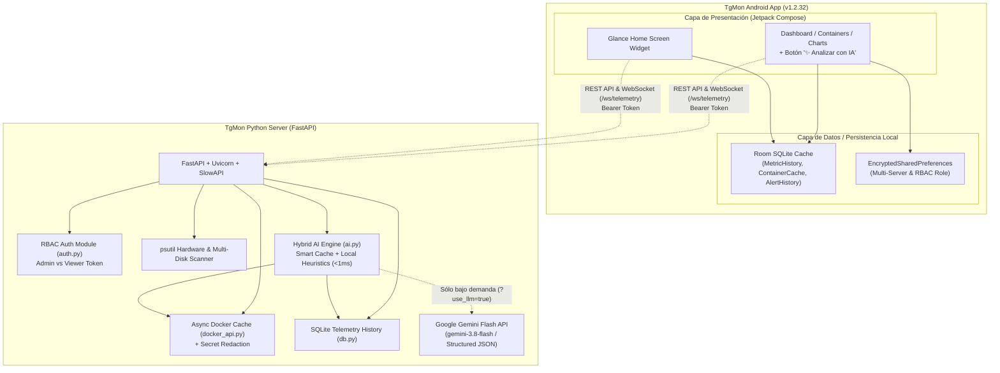

# TgMon v2 - Real-Time Server, Docker & AI Predictive Monitoring System

**TgMon v2 (`v1.2.32`)** is a full-stack infrastructure telemetry, Docker container lifecycle management, and AI-assisted predictive monitoring solution comprising:

1. **Python FastAPI Backend (`server/`)**:
   - Collects real-time hardware telemetry (CPU, RAM, multi-partition & external USB/SATA disks, network I/O) and Docker container states via an asynchronous background cache (`docker_api.py`).
   - **Role-Based Access Control (RBAC)**: Dual-token security (`TGMON_ADMIN_TOKEN` for full control and `TGMON_VIEWER_TOKEN` for read-only Viewer Mode) with constant-time comparison (`secrets.compare_digest`), secure token invalidation lockfile (`0o600`), and rate limiting (`slowapi`).
   - **Hybrid AI & Predictive Engine (`ai.py`)**:
     - **Fast Local Heuristic Mode (`use_llm=false`, `<1 ms`)**: Zero-quota background analysis of SQLite telemetry trends (`get_history`) and cached container CPU metrics.
     - **On-Demand Gemini Flash Mode (`use_llm=true`)**: Triggered explicitly via the **"✨ Analizar con IA"** button in the Android app. Queries **Google Gemini Flash (`gemini-3.8-flash` / `gemini-3.5-flash-lite`)** with structured JSON schema validation (`Pydantic`), prompt secret sanitization, a **Smart Cache** (`120s` TTL + `10%` CPU/RAM delta check), zero-dependency native `urllib.request` REST fallback, and automatic fallback to the local heuristic engine if offline or unconfigured.
2. **Android Native Client (`app/`)**:
   - Built with **Kotlin**, **Jetpack Compose (Material 3)**, **Hilt**, **Retrofit/OkHttp WebSockets**, **Room SQLite Cache**, and **Glance Home Screen Widgets**.
   - **Single-Screen Overview**: Displays real-time CPU/RAM gauges, **Multi-Disk Horizontal Pager** (`DiskUsageCard.kt`), **AI Prediction Card** with on-demand **"✨ Analizar con IA"**, and a **2x2 Top 4 Active Containers** grid.
   - **Containers & Grouped AI Recommendations**: Full container lifecycle controls (`start`, `stop`, `restart`, `pause`, `unpause`, live logs) and an expandable **AI Recommendations Card** that groups identical container diagnostics to save screen space.

---

## Architecture Overview



---

## 1. Server Setup (Backend)

### Prerequisites
- Python 3.10+ (Python 3.12 used in Docker and CI)
- Optional: Docker Engine running locally (for container monitoring and management)

### Installation & Run (Local Virtual Environment)

1. Navigate to the `server/` directory:
   ```bash
   cd server
   ```
2. Create and activate a Python virtual environment:
   - **Linux / macOS**:
     ```bash
     python3 -m venv venv
     source venv/bin/activate
     ```
   - **Windows**:
     ```cmd
     python -m venv venv
     venv\Scripts\activate
     ```
3. Install required packages:
   ```bash
   pip install -r requirements.txt
   ```
4. Configure environment variables in `app/.env.api` (or `.env`):
   ```env
   TGMON_ADMIN_TOKEN=shodan_secret_2026
   TGMON_VIEWER_TOKEN=shodan_viewer_2026
   TGMON_TOKEN=shodan_secret_2026
   # Optional: Google AI Studio API Key for on-demand "✨ Analizar con IA"
   GEMINI_API_KEY=your_gemini_api_key_here
   ```
5. Start the server:
   ```bash
   uvicorn --app-dir app main:app --host 0.0.0.0 --port 8000
   ```
6. Run the automated backend test suite (43 tests):
   ```bash
   pytest tests/test_api.py -v
   ```

### Docker Compose Deployment (`server/docker-compose.yml`)
```bash
docker compose up -d
```
Because `./app` is mounted as a live volume (`- ./app:/app/app`) and `ai.py` reads `app/.env.api` dynamically using Python's built-in `urllib.request`, updating `GEMINI_API_KEY` in `app/.env.api` only requires `docker restart tgmon`.

---

## 2. Android App Setup (Client)

### Prerequisites
- Android Studio (Koala / Ladybug or newer)
- JDK 17 (`jbr` bundled with Android Studio)
- Android SDK (API Level 26 minimum, API 35 target)

### Building & Testing via Gradle
```bash
./gradlew testDebugUnitTest assembleDebug
```
Pre-built debug APK in repository root:
- `TGMon-v2-debug.apk` (`TGMon-v2-1.2.32-debug.apk`)

---

## 3. Key Endpoints

| Endpoint | Method | Role | Description |
| :--- | :---: | :---: | :--- |
| `/health` | `GET` | Viewer / Admin | Instant snapshot of CPU, RAM, multi-disk partitions (`disks`), and Docker summary. |
| `/status` | `GET` | Viewer / Admin | System uptime, load average, and `dockerd`/`sshd` process status. |
| `/history` | `GET` | Viewer / Admin | Historical telemetry records from SQLite (`?hours=1..8760`). |
| `/history/csv` | `GET` | Viewer / Admin | CSV export of historical telemetry metrics. |
| `/ai/predict-spike` | `GET` | Viewer / Admin | CPU/RAM saturation prediction (`?use_llm=false` fast heuristics; `?use_llm=true` Gemini Flash + Smart Cache). |
| `/ai/recommendations` | `GET` | Viewer / Admin | Idle container optimization (`?use_llm=false` fast heuristics; `?use_llm=true` Gemini Flash + Smart Cache). |
| `/docker/containers` | `GET` | Viewer / Admin | List of Docker containers with multi-core CPU %, RAM usage, health status, and ports. |
| `/docker/containers/{id}/{action}` | `POST` | **Admin only** | Container lifecycle actions: `restart`, `start`, `stop`, `pause`, `unpause`. |
| `/docker/containers/{id}` | `DELETE` | **Admin only** | Remove a stopped container (`?force=true` optional). |
| `/docker/containers/{id}/logs` | `GET` | Viewer / Admin | Container stdout/stderr log stream with automatic secret redaction. |
| `/docker/containers/{id}/details` | `GET` | Viewer / Admin | Detailed inspection of container mounts, networks, and redacted environment variables. |
| `/auth/verify` | `GET` | Viewer / Admin | Validates Bearer token and returns assigned role (`admin` or `viewer`). |
| `/auth/invalidate` | `POST` | **Admin only** | Emergency token lock (`0o600` lockfile). |
| `/auth/reenable` | `POST` | **Admin only** | Restores invalidated token access. |
| `/ws/telemetry` | `WS` | Viewer / Admin | Real-time bi-directional telemetry and Docker event streaming. |

---

## 4. Security & Privacy Highlights

- **Constant-Time Auth & RBAC**: Tokens are verified using `secrets.compare_digest` with strict role separation (`admin` vs `viewer`).
- **Prompt & Log Sanitization**: Sensitive environment variables, tokens, and passwords are automatically redacted (`***REDACTED***`) in container logs (`docker_api.py`) and before any prompt is sent to Gemini (`ai.py`).
- **Container ID Validation**: Strict hexadecimal validation (`12..64` chars) prevents command or path injection.
- **Zero-Data-Retention AI Calls**: Gemini requests use only anonymized numeric telemetry and container status summaries.
