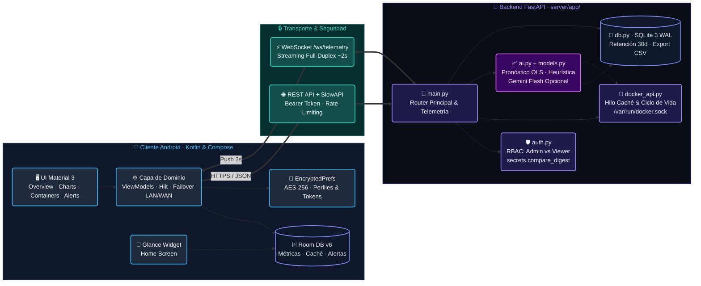

# TGMon v2 — Observabilidad Móvil de Infraestructura Docker y Analítica Predictiva


-success?style=flat-square)
-red?style=flat-square)

**TGMon v2 (`v1.2.34`, `VERSION_CODE=34`)** es un sistema cliente-servidor para supervisar servidores Linux con contenedores Docker desde dispositivos Android, combinando telemetría en tiempo real, administración controlada por roles y un monitor predictivo de recursos.

- **Asignatura**: Programación de Vanguardia — Licenciatura en Tecnologías Informáticas (Universidad de la Ciudad de Buenos Aires, Ciclo Lectivo 2026)
- **Docente**: Ing. Alejandro Vázquez
- **Equipo de Desarrollo**: Rodrigo Carme, Luis Alberto Quispe, Roberto Carlos Barragán y Gastón Joel Leppen
- **Repositorio**: [`https://github.com/Rcarme/UdelaCiudad`](https://github.com/Rcarme/UdelaCiudad)
- **Registro de Minutas y Gestión Ágil**: [`MINUTAS.md`](MINUTAS.md) e [Issues del repositorio (`#1` a `#13`)](https://github.com/Rcarme/UdelaCiudad/issues)

---

## 1. Arquitectura del Sistema

El proyecto implementa una arquitectura cliente-servidor aprobada por la cátedra, compuesta por:

1. **Cliente Nativo Android (`app/`)**:
   - Desarrollado en **Kotlin** con **Jetpack Compose (Material 3)**, **Dagger Hilt**, **Coroutines/StateFlow**, **Retrofit 2**, **OkHttp WebSockets**, **Room SQLite (`v6`)** y **Glance AppWidget**.
   - Organizado en capas de presentación (`presentation/screens/`, `presentation/viewmodel/`, `presentation/components/`), dominio (`domain/`) y datos (`data/api/`, `data/database/`, `data/models/`, `data/preferences/`).
2. **Backend Modular en Python / FastAPI (`server/app/`)**:
   - Todos los módulos de producción residen en `server/app/` (`main.py`, `auth.py`, `ai.py`, `models.py`, `db.py`, `docker_api.py`) y **comparten una única instancia de aplicación FastAPI** ejecutada sobre Uvicorn. La separación por módulos organiza las responsabilidades internas (seguridad RBAC, telemetría del host, integración con Docker Engine, persistencia SQLite y analítica predictiva) dentro de un mismo proceso de bajo consumo.



---

## 2. Estructura Actual del Repositorio

```text
.
├── app/                                  # Aplicación Android (Kotlin / Jetpack Compose)
│   ├── build.gradle.kts
│   └── src/
│       ├── main/java/com/tgmon/app/
│       │   ├── data/                     # API Retrofit, Room DB (v6), DTOs y Preferencias Cifradas
│       │   ├── di/                       # Módulo de inyección de dependencias (Hilt)
│       │   ├── domain/                   # Repositorio, gestores de alertas y caché
│       │   ├── presentation/             # Pantallas Compose, ViewModels y gráficos (LineChart.kt)
│       │   ├── ui/theme/                 # Tema visual Material 3
│       │   └── widget/                   # Widget de escritorio (Glance + WorkManager)
│       └── test/java/com/tgmon/app/      # 11 suites de pruebas unitarias JUnit 4 (50 casos)
├── server/                               # Backend Python / FastAPI
│   ├── app/                              # Única fuente de módulos Python de producción
│   │   ├── main.py                       # Instancia FastAPI, endpoints REST, WebSocket y telemetría
│   │   ├── auth.py                       # Validación de tokens (secrets.compare_digest) y RBAC
│   │   ├── ai.py                         # Pronóstico OLS (/ai/forecast), heurísticas y cliente Gemini
│   │   ├── models.py                     # Esquemas Pydantic de validación de respuestas
│   │   ├── db.py                         # Persistencia histórica en SQLite 3 (modo WAL)
│   │   └── docker_api.py                 # Integración con Docker SDK, caché y redacción de logs
│   ├── tests/                            # Suite de pruebas automatizadas del backend
│   │   ├── conftest.py                   # Configuración de sys.path hacia server/app
│   │   └── test_api.py                   # 43 pruebas automatizadas con pytest y TestClient
│   ├── requirements.txt                  # Dependencias Python del backend
│   ├── Dockerfile                        # Imagen python:3.12-slim ejecutando app/main.py
│   ├── docker-compose.yml                # Definición de despliegue con variables obligatorias
│   ├── .env.example                      # Plantilla de variables de entorno sin secretos
│   ├── update_shodan.sh                  # Script de actualización y verificación segura
│   ├── diagnose.sh                       # Script de diagnóstico local del servidor
│   └── start_test.bat                    # Script de arranque local en Windows
├── .github/workflows/ci.yml              # Pipeline CI (pruebas Android + APK y pytest en server/)
├── LICENSE                               # Licencia de propiedad intelectual exclusiva (Rodrigo Carme)
├── MINUTAS.md                            # Registro de minutas del equipo y trazabilidad ágil
├── version.properties                    # Fuente de versión actual (VERSION_NAME=1.2.34, VERSION_CODE=34)
└── README.md
```

---

## 3. Funcionalidades Implementadas

- **Gestión de Perfiles de Servidor**: Alta, edición, selección y baja de servidores monitoreados en Android, con soporte de dirección local (LAN) y remota (WAN/VPN).
- **Autenticación y Autorización por Roles (`admin` / `viewer`)**:
  - Comparación en tiempo constante (`secrets.compare_digest`) en [`server/app/auth.py`](server/app/auth.py).
  - El rol `viewer` tiene acceso exclusivo de lectura (métricas, gráficos, estado y logs de contenedores); cualquier intento de mutación devuelve `HTTP 403 Forbidden`.
  - El rol `admin` habilita operaciones de ciclo de vida de contenedores (`start`, `stop`, `restart`, `pause`, `unpause`, `delete`) y bloqueo/rehabilitación de credenciales (`/auth/invalidate`, `/auth/reenable`).
- **Telemetría en Tiempo Real y Multi-Disco**:
  - Difusión periódica por WebSocket (`/ws/telemetry` cada ~2 segundos) y endpoints REST (`/health`, `/status`).
  - Detección de particiones internas y puntos de montaje externos (`/media`, `/mnt`, `/run/media`) presentados en un carrusel deslizable (`DiskUsageCard.kt`).
- **Predictor Estadístico OLS (`GET /ai/forecast`) y Gráficos en Android**:
  - Implementado en [`server/app/ai.py`](server/app/ai.py) (`forecast_resources()`) mediante regresión lineal ordinaria por mínimos cuadrados (OLS) sobre la ventana reciente de métricas de SQLite (`window_minutes=60` por defecto).
  - Calcula pendiente en puntos porcentuales por minuto (`slope_per_min`), coeficiente de determinación (`r_squared`), dirección de tendencia (`rising`, `falling`, `stable`), banda aproximada de predicción al 95 % (`±1.96 * se`) acotada a `[0, 100]` y tiempo estimado hasta el umbral crítico del 85 % (`eta_minutes_to_threshold`).
  - Consumido por Android en [`ChartsViewModel.kt`](app/src/main/java/com/tgmon/app/presentation/viewmodel/ChartsViewModel.kt), [`DashboardViewModel.kt`](app/src/main/java/com/tgmon/app/presentation/viewmodel/DashboardViewModel.kt), [`ChartsScreen.kt`](app/src/main/java/com/tgmon/app/presentation/screens/ChartsScreen.kt) y renderizado en [`LineChart.kt`](app/src/main/java/com/tgmon/app/presentation/components/LineChart.kt) como serie proyectada punteada con banda sombreada y línea de umbral al 85 %.
- **Diagnóstico Heurístico y Consulta Opcional con IA (`/ai/predict-spike` y `/ai/recommendations`)**:
  - Por defecto (`use_llm=false`), evalúa umbrales y variaciones recientes de CPU/RAM e identifica contenedores con actividad baja desde la caché en segundo plano sin consumir cuota externa.
  - Cuando el usuario pulsa explícitamente **"✨ Analizar con IA"** (`use_llm=true`), consulta de forma opcional la API de Gemini con validación Pydantic, caché en memoria (`TTL = 120s`) y *fallback* automático al diagnóstico heurístico local si no hay clave configurada o falla la red.
- **Persistencia Dual (SQLite WAL + Room)**:
  - **Servidor ([`server/app/db.py`](server/app/db.py))**: SQLite 3 en modo `WAL` (`Write-Ahead Logging`) con escritura periódica (~300 s), retención de 30 días y exportación CSV (`/history/csv`).
  - **Cliente Android ([`AppDatabase.kt`](app/src/main/java/com/tgmon/app/data/database/AppDatabase.kt))**: Esquema Room versión 6 (`MetricHistory`, `ContainerCache`, `ContainerLog`, `AlertHistory`) con migraciones explícitas y almacenamiento de credenciales en `EncryptedSharedPreferences`.

---

## 4. Configuración y Ejecución del Backend (`server/`)

### Requisitos Previos
- Python 3.10 o superior (Python 3.12 en Docker y GitHub Actions).
- Docker Engine (opcional en desarrollo local; necesario para inspeccionar y operar contenedores reales).

### Instalación de Dependencias
```bash
cd server
python3 -m venv venv
# En Linux / macOS:
source venv/bin/activate
# En Windows (PowerShell / CMD):
# venv\Scripts\activate

pip install -r requirements.txt
```

### Configuración Segura de Tokens
1. Copiar la plantilla [`.env.example`](server/.env.example) a `.env` (o `app/.env.api`):
   ```bash
   cp .env.example .env
   chmod 600 .env
   ```
2. Generar tokens aleatorios para cada rol:
   ```bash
   openssl rand -hex 32
   ```
3. Configurar los valores en `.env` (y opcionalmente en `app/.env.api`):
   ```env
   TGMON_ADMIN_TOKEN=<token_admin_generado>
   TGMON_VIEWER_TOKEN=<token_viewer_generado_o_vacio_para_deshabilitar>
   TGMON_TOKEN=<token_admin_generado>
   # Opcional: clave para consultas bajo demanda (?use_llm=true)
   # GEMINI_API_KEY=<clave_opcional>
   ```
   > **Importante**: Nunca reutilice valores de ejemplo en entornos reales ni versione archivos `.env` o `.env.api`.

### Ejecución Local del Backend
Desde el directorio `server/`:
```bash
uvicorn --app-dir app main:app --host 127.0.0.1 --port 8000
```
*(Para aceptar conexiones desde un dispositivo Android en la misma red local controlada, utilice `--host 0.0.0.0`).*

### Ejecución mediante Docker Compose
Desde el directorio `server/`, habiendo definido `TGMON_ADMIN_TOKEN` en `.env` o en el entorno (`docker-compose.yml` exige `${TGMON_ADMIN_TOKEN:?definir TGMON_ADMIN_TOKEN}` y aborta si falta):
```bash
docker compose up -d --build
```

---

## 5. Pruebas Automatizadas (Backend y Android)

### Pruebas del Backend Python (`pytest`)
Desde el directorio `server/`:
```bash
pytest tests/test_api.py -v
```
- [`server/tests/conftest.py`](server/tests/conftest.py) agrega `server/app` a `sys.path`, garantizando que las pruebas validen exactamente los mismos módulos que ejecuta Docker en producción.
- **Resultado actual verificado**: **43 pruebas aprobadas** (`0` fallos, `0` errores), cubriendo autenticación, RBAC (`admin`/`viewer`), telemetría, multi-disco, SQLite, Docker, WebSocket, heurísticas/caché de IA y los 6 casos del pronóstico OLS (`/ai/forecast`).

### Pruebas Unitarias y Compilación Android (`Gradle / JUnit 4`)
Desde la raíz del repositorio:
```bash
./gradlew testDebugUnitTest assembleDebug
```
- **Resultado actual verificado**: **50 pruebas unitarias aprobadas** distribuidas en 11 suites JUnit 4 (`AlertHistoryTest`, `ContainerListResponseTest`, `DockerContainerTest`, `ForecastResponseTest`, `MetricHistoryDtoTest`, `MultiDiskTest`, `NotificationSafetyTest`, `RolePermissionsTest`, `ThresholdAlertLogicTest`, `ServerConfigValidationTest` y `ExampleUnitTest`), sin fallos ni errores.

---

## 6. Principales Endpoints de la API

| Método | Ruta | Rol Requerido | Descripción |
| :---: | :--- | :---: | :--- |
| `GET` | `/auth/verify` | Viewer / Admin | Valida el Bearer token y devuelve el rol asignado (`admin` o `viewer`). |
| `POST` | `/auth/invalidate` · `/auth/reenable` | **Admin** | Invalida o rehabilita el acceso por token mediante lockfile seguro (`0o600`). |
| `GET` | `/health` · `/status` | Viewer / Admin | Estado actual de CPU, RAM, particiones de disco (`disks`), uptime y demonios. |
| `GET` | `/history` · `/history/csv` | Viewer / Admin | Serie temporal de métricas en SQLite (`?hours=1..8760`) y exportación CSV. |
| `WS` | `/ws/telemetry` | Viewer / Admin | Canal WebSocket autenticado para telemetría e información de contenedores. |
| `GET` | `/docker/containers` | Viewer / Admin | Lista de contenedores con uso de CPU multi-núcleo, RAM, estado y antigüedad de caché. |
| `GET` | `/docker/containers/{id}/logs` · `/details` | Viewer / Admin | Registros e inspección de contenedor con redacción de variables sensibles. |
| `GET` | `/docker/service-urls` | Viewer / Admin | Descubrimiento de puertos HTTP publicados en `docker-compose.yml`. |
| `POST` | `/docker/containers/{id}/{action}` | **Admin** | Acciones de ciclo de vida: `start`, `stop`, `restart`, `pause`, `unpause`. |
| `DELETE` | `/docker/containers/{id}` | **Admin** | Eliminación de contenedor detenido (`?force=true` opcional). |
| `GET` | `/ai/forecast` | Viewer / Admin | Pronóstico lineal OLS (`window_minutes`, `horizon_minutes`), pendiente, $R^2$, banda 95 % y ETA al 85 %. |
| `GET` | `/ai/predict-spike` | Viewer / Admin | Clasificación heurística de riesgo de CPU/RAM y análisis opcional (`?use_llm=true`). |
| `GET` | `/ai/recommendations` | Viewer / Admin | Sugerencias sobre contenedores con baja actividad y consulta opcional (`?use_llm=true`). |

---

## 7. Limitaciones Conocidas del MVP

- **Alcance de laboratorio personal / instancia única**: El backend está diseñado para supervisar un host específico y no incluye coordinación multi-nodo ni alta disponibilidad.
- **Transporte y exposición de red**: El acceso al socket de Docker (`/var/run/docker.sock`) otorga privilegios elevados al contenedor del backend; el servicio no debe exponerse directamente a Internet público sin TLS (HTTPS/WSS) o una red privada cifrada (VPN/Tailscale).
- **Aislamiento multi-servidor en el cliente**: Las entidades locales de caché en Room almacenan muestras sin clave foránea por perfil de servidor y el proveedor de token HTTP opera sobre el perfil activo; para entornos con múltiples servidores simultáneos se prevé vincular cada cliente e historial al identificador de perfil.
- **Revocación de sesiones WebSocket activas**: La invalidación de tokens bloquea inmediatamente nuevas solicitudes HTTP y nuevos handshakes WebSocket, pero no fuerza el cierre inmediato de conexiones WebSocket abiertas previamente.
- **Naturaleza orientativa del pronóstico OLS y heurísticas**: El ajuste lineal sobre una ventana corta proyecta tendencias locales pero no modela estacionalidad compleja, y una lectura puntual de baja CPU en un contenedor no implica que el servicio sea prescindible; toda acción requiere confirmación humana.

---

## 8. Evidencia Académica y Entregables

- **Minutas y seguimiento ágil**: Disponibles en el repositorio en [`MINUTAS.md`](MINUTAS.md) y vinculadas con las [Issues `#1` a `#13` y Milestones (`Sprint 1`, `Sprint 2`, `Sprint 3`) en GitHub](https://github.com/Rcarme/UdelaCiudad/issues).
- **Documentación extensa, informes finales (Word/PDF) y presentación**: Por higiene del repositorio (ver [`.gitignore`](.gitignore)), la carpeta local `docs/` (que contiene `docs/entrega_2026/INFORME_TGMON.docx`, `docs/entrega_2026/AUDITORIA_TGMON.docx`, `docs/INFORME_PROYECTO_INTEGRADOR.md`, capturas de alta resolución y reportes XML de pruebas en `docs/entrega_2026/evidencias/`) y los documentos generados en la raíz (`/*.docx`, `/*.pdf`, `/*.pptx`) se conservan localmente en el entorno del equipo y se entregan por separado a la cátedra.
