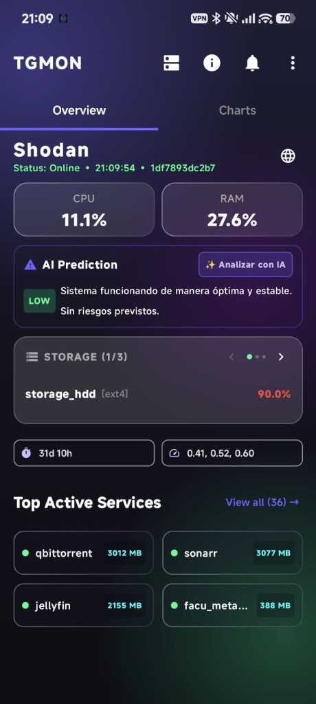
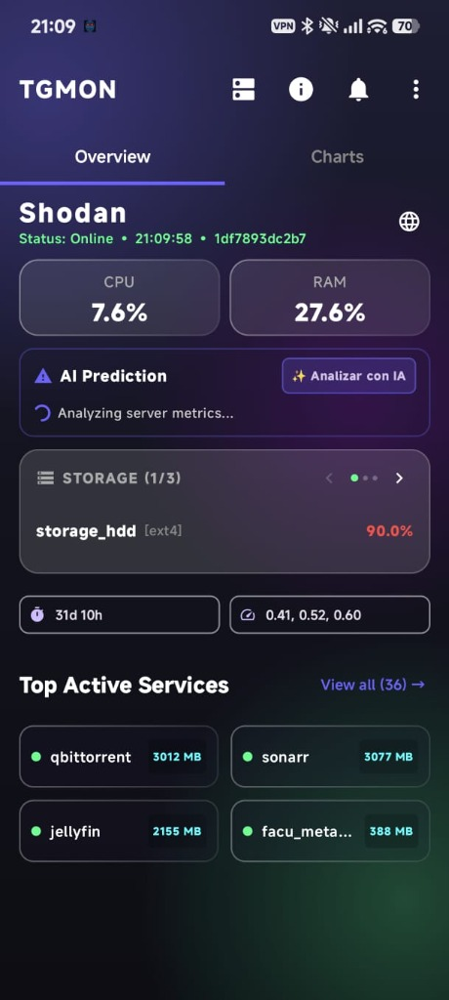
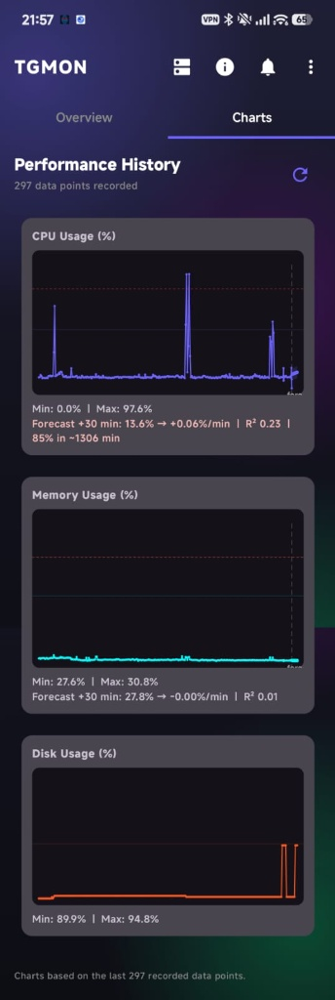
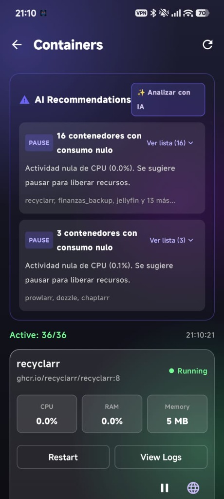
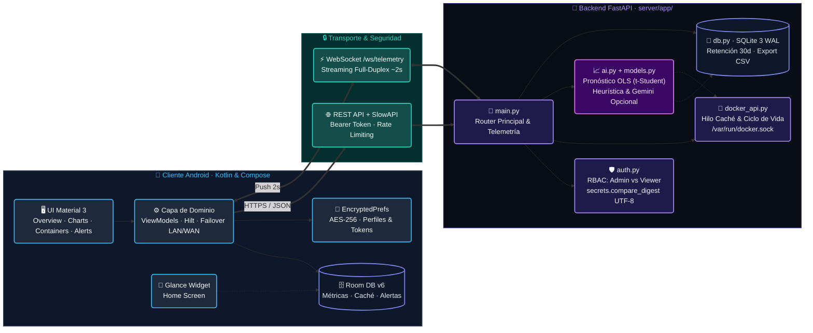

# TGMon v2 — Monitoreo Móvil de Servidores Docker con RBAC y Pronóstico OLS

[](https://github.com/Rcarme/UdelaCiudad/actions/workflows/ci.yml)


-red?style=flat-square)

**TGMon v2** (versión fuente en [`version.properties`](version.properties)) es una aplicación nativa Android (**Kotlin / Jetpack Compose**) y un backend **FastAPI** para supervisar servidores Linux con contenedores Docker, con control de acceso basado en roles (**RBAC**) y pronóstico de saturación de CPU/RAM mediante regresión lineal (**OLS**).

> **Nota sobre nomenclatura del repositorio**:
> - **TGMon v2**: Nombre del sistema cliente-servidor.
> - **UdelaCiudad**: Nombre del repositorio académico para la asignatura *Programación de Vanguardia* (Universidad de la Ciudad de Buenos Aires, Ciclo Lectivo 2026 — Docente: Ing. Alejandro Vázquez).
> - **Shodan**: Nombre del servidor Linux homelab de referencia donde se ejecuta el entorno productivo (`server/update_shodan.sh`, `shodan_icon.png`).
> - **Equipo**: Rodrigo Carme, Luis Alberto Quispe, Roberto Carlos Barragán y Gastón Joel Leppen · **Gestión Ágil**: [`MINUTAS.md`](MINUTAS.md) e [Issues `#1`–`#13`](https://github.com/Rcarme/UdelaCiudad/issues).

---

## Quick Start (5 líneas)

```bash
cd server && python -m venv venv && source venv/bin/activate && pip install -r requirements.txt
export TGMON_ADMIN_TOKEN="$(openssl rand -hex 32)"
uvicorn --app-dir app main:app --host 127.0.0.1 --port 8000
pytest tests/test_api.py -v                        # Ejecutar suite de pruebas del backend
cd .. && ./gradlew testDebugUnitTest assembleDebug # Ejecutar pruebas unitarias y compilar APK Android
```

---

## Vista Previa de la Aplicación Android

| Dashboard & Multi-Disco | Diagnóstico Heurístico / IA | Pronóstico OLS (Banda 95 %) | Contenedores & Agrupación |
| :---: | :---: | :---: | :---: |
|  |  |  |  |

---

## 1. Arquitectura del Sistema

1. **Cliente Nativo Android (`app/`)**:
   - Desarrollado en **Kotlin** con **Jetpack Compose (Material 3)**, **Dagger Hilt**, **Coroutines/StateFlow**, **Retrofit 2**, **OkHttp WebSockets**, **Room SQLite (`v6`)** y **Glance AppWidget**.
   - Organizado en capas de presentación (`presentation/screens/`, `presentation/viewmodel/`, `presentation/components/`), dominio (`domain/`) y datos (`data/api/`, `data/database/`, `data/models/`, `data/preferences/`).
2. **Backend Modular en Python / FastAPI (`server/app/`)**:
   - Los módulos de producción residen en el paquete `server/app/` (`main.py`, `auth.py`, `ai.py`, `models.py`, `db.py`, `docker_api.py`) y comparten una única instancia FastAPI sobre Uvicorn.



---

## 2. Estructura del Repositorio

```text
.
├── assets/                               # Capturas de pantalla de la app Android
├── app/                                  # Aplicación Android (Kotlin / Jetpack Compose)
│   ├── build.gradle.kts
│   └── src/
│       ├── main/java/com/tgmon/app/
│       │   ├── data/                     # API Retrofit, Room DB (v6), DTOs y Preferencias Cifradas
│       │   ├── di/                       # Módulo de inyección de dependencias (Hilt)
│       │   ├── domain/                   # Repositorio, gestores de alertas y caché
│       │   ├── presentation/             # Pantallas Compose, ViewModels y gráficos (LineChart.kt)
│       │   ├── ui/theme/                 # Tema visual Material 3
│       │   └── widget/                   # Widget de escritorio (Glance + WorkManager)
│       └── test/java/com/tgmon/app/      # Suites de pruebas unitarias JUnit 4
├── server/                               # Backend Python / FastAPI
│   ├── app/                              # Paquete Python de producción
│   │   ├── __init__.py
│   │   ├── main.py                       # Instancia FastAPI, endpoints REST, WebSocket y telemetría
│   │   ├── auth.py                       # Validación Bearer UTF-8 (secrets.compare_digest) y RBAC
│   │   ├── ai.py                         # Pronóstico OLS (t-Student), heurísticas y cliente Gemini
│   │   ├── models.py                     # Esquemas Pydantic de validación de respuestas
│   │   ├── db.py                         # Persistencia histórica en SQLite 3 (modo WAL)
│   │   └── docker_api.py                 # Integración con Docker SDK, caché thread-safe y redacción
│   ├── tests/                            # Suite de pruebas automatizadas del backend (pytest)
│   │   ├── conftest.py
│   │   └── test_api.py
│   ├── requirements.txt
│   ├── Dockerfile
│   ├── docker-compose.yml
│   └── .env.example
├── .github/workflows/ci.yml              # Pipeline CI (Gradle Unit Tests + APK + pytest)
├── LICENSE                               # Licencia de propiedad intelectual exclusiva (Rodrigo Carme)
├── MINUTAS.md                            # Registro de minutas del equipo y trazabilidad ágil
├── version.properties                    # Fuente única de versión (VERSION_NAME / VERSION_CODE)
└── README.md
```

---

## 3. Funcionalidades Principales

- **Autenticación y Autorización por Roles (`admin` / `viewer`)**:
  - Comparación en tiempo constante codificada en UTF-8 (`secrets.compare_digest`) y esquema `Bearer` case-insensitive según RFC 7235 en [`server/app/auth.py`](server/app/auth.py).
  - El rol `viewer` tiene acceso exclusivo de lectura; cualquier intento de mutación devuelve `HTTP 403 Forbidden`.
  - El rol `admin` habilita acciones de ciclo de vida de contenedores (`start`, `stop`, `restart`, `pause`, `unpause`, `delete`) y bloqueo/rehabilitación de tokens (`/auth/invalidate`, `/auth/reenable`).
- **Telemetría en Tiempo Real y Multi-Disco**:
  - Difusión periódica por WebSocket (`/ws/telemetry` cada ~2 segundos) y endpoints REST (`/health`, `/status`).
  - Detección de particiones internas y puntos de montaje externos (`/media`, `/mnt`, `/run/media`) en un carrusel deslizable (`DiskUsageCard.kt`).
- **Predictor Estadístico OLS (`GET /ai/forecast`)**:
  - Implementado en [`server/app/ai.py`](server/app/ai.py) (`forecast_resources()`) mediante regresión lineal ordinaria por mínimos cuadrados (OLS) sobre la ventana reciente de métricas en SQLite (`window_minutes=60` por defecto).
  - Calcula pendiente por minuto (`slope_per_min`), coeficiente de determinación ($R^2$), banda de predicción al 95 % usando el **cuantil $t$ de Student con $n-2$ grados de libertad** ($\hat{y} \pm t_{0.975, n-2} \cdot s \sqrt{1 + 1/n + (x - \bar{x})^2 / S_{xx}}$) acotada a $[0, 100]$, y tiempo estimado hasta el umbral crítico del 85 % (`minutes_to_threshold`) exigiendo tendencia creciente y un ajuste mínimo ($R^2 \ge 0.25$) para evitar falsas alarmas sobre ruido.
- **Diagnóstico Heurístico y Consulta Opcional con Gemini (`/ai/predict-spike` y `/ai/recommendations`)**:
  - Por defecto (`use_llm=false`), evalúa umbrales y variaciones de CPU y RAM sobre una ventana fija de 15 minutos e identifica contenedores con actividad nula sólo cuando existen mediciones reales de CPU en caché.
  - Bajo demanda (`use_llm=true`), consulta la API de Gemini con validación Pydantic, caché thread-safe (`TTL = 120s`) y *fallback* automático al motor heurístico local.
- **Persistencia Dual (SQLite WAL + Room v6)**:
  - **Servidor ([`server/app/db.py`](server/app/db.py))**: SQLite 3 en modo `WAL` con retención automática de 30 días y exportación CSV (`/history/csv`).
  - **Cliente Android ([`AppDatabase.kt`](app/src/main/java/com/tgmon/app/data/database/AppDatabase.kt))**: Esquema Room v6 con migraciones explícitas y credenciales cifradas en `EncryptedSharedPreferences`.

---

## 4. Configuración y Despliegue del Backend (`server/`)

1. Copiar [`.env.example`](server/.env.example) a `.env` y configurar tokens aleatorios (`openssl rand -hex 32`):
   ```env
   TGMON_ADMIN_TOKEN=<token_admin_generado>
   TGMON_VIEWER_TOKEN=<token_viewer_opcional>
   TGMON_TOKEN=<token_admin_generado>
   # GEMINI_API_KEY=<clave_opcional_para_use_llm_true>
   ```
2. Ejecutar con Docker Compose:
   ```bash
   cd server && docker compose up -d --build
   ```

---

## 5. Principales Endpoints de la API

| Método | Ruta | Rol Requerido | Descripción |
| :---: | :--- | :---: | :--- |
| `GET` | `/auth/verify` | Viewer / Admin | Valida el Bearer token y devuelve el rol asignado (`admin` o `viewer`). |
| `POST` | `/auth/invalidate` · `/auth/reenable` | **Admin** | Invalida o rehabilita el acceso por token mediante lockfile seguro (`0o600`). |
| `GET` | `/health` · `/status` | Viewer / Admin | Estado actual de CPU, RAM, particiones de disco (`disks`), uptime y demonios. |
| `GET` | `/history` · `/history/csv` | Viewer / Admin | Serie temporal de métricas en SQLite (`?hours=1..8760`) y exportación CSV. |
| `WS` | `/ws/telemetry` | Viewer / Admin | Canal WebSocket autenticado para telemetría e información de contenedores. |
| `GET` | `/docker/containers` | Viewer / Admin | Lista de contenedores con uso de CPU multi-núcleo, RAM, estado y antigüedad de caché. |
| `GET` | `/docker/containers/{id}/logs` · `/details` | Viewer / Admin | Registros e inspección de contenedor con redacción de variables sensibles. |
| `POST` | `/docker/containers/{id}/{action}` | **Admin** | Acciones de ciclo de vida: `start`, `stop`, `restart`, `pause`, `unpause`. |
| `DELETE` | `/docker/containers/{id}` | **Admin** | Eliminación de contenedor detenido (`?force=true` opcional). |
| `GET` | `/ai/forecast` | Viewer / Admin | Pronóstico lineal OLS (`window_minutes`, `horizon_minutes`), pendiente, $R^2$, banda $t$-Student 95 % y ETA al 85 %. |
| `GET` | `/ai/predict-spike` | Viewer / Admin | Clasificación heurística de riesgo de CPU/RAM y análisis opcional (`?use_llm=true`). |
| `GET` | `/ai/recommendations` | Viewer / Admin | Sugerencias sobre contenedores con baja actividad medida y consulta opcional (`?use_llm=true`). |

---

## 6. Limitaciones Conocidas del MVP

- **Alcance de instancia única**: El backend supervisa un host específico y no incluye coordinación multi-nodo.
- **Exposición de red**: El acceso a `/var/run/docker.sock` otorga privilegios elevados; no debe exponerse a Internet público sin TLS (HTTPS/WSS) o VPN (Tailscale/WireGuard).
- **Aislamiento multi-servidor en el cliente**: Las tablas de caché en Room almacenan muestras del perfil activo; para entornos multi-host simultáneos se prevé vincular cada registro al ID de perfil.
- **Revocación de sesiones**: La invalidación por lockfile bloquea nuevas solicitudes HTTP y nuevos handshakes WebSocket; si se recrea el contenedor sin volumen persistente en caché, el estado se reinicia.
- **Naturaleza orientativa del pronóstico OLS**: El ajuste lineal sobre ventana corta proyecta tendencias locales con distribución $t$ de Student ($n-2$ gl) y filtro $R^2 \ge 0.25$, pero no modela estacionalidad compleja.
