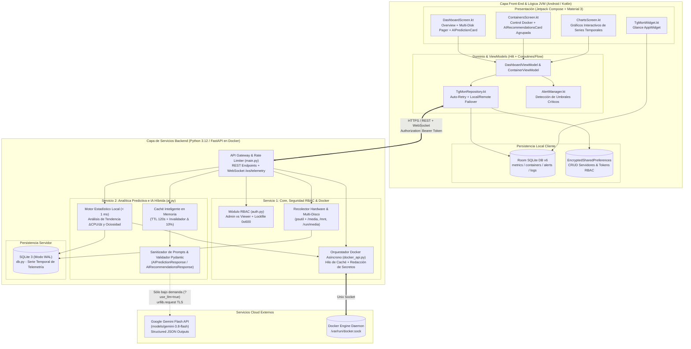
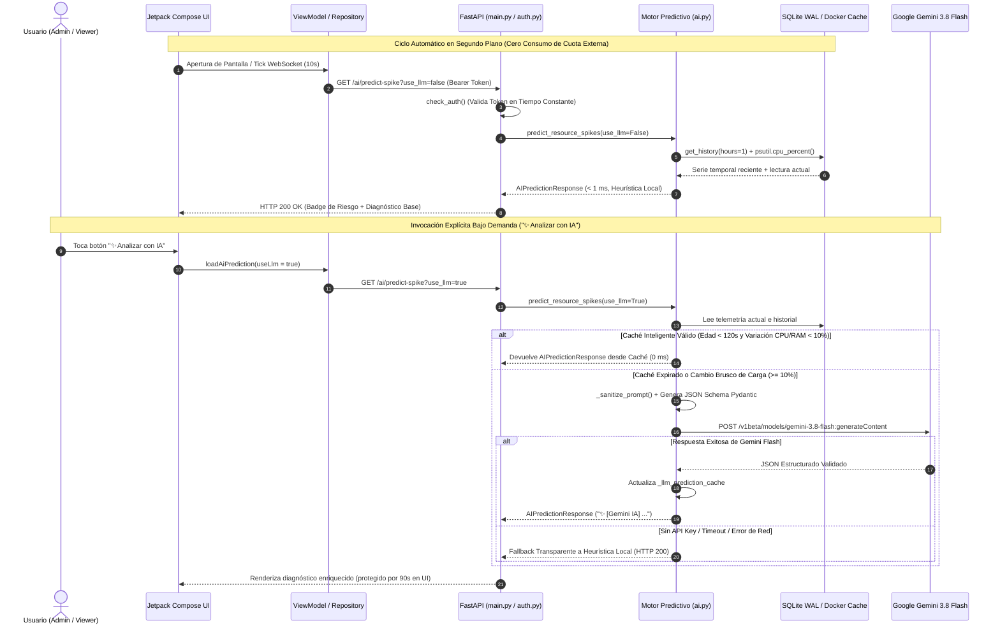
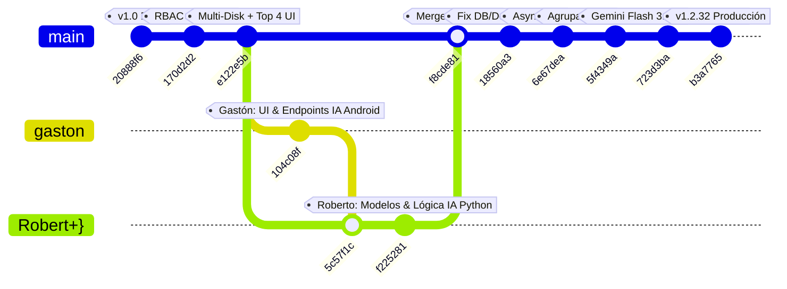

# Trabajo Práctico — Proyecto Integrador: TGMon v2
## Sistema Inteligente de Telemetría en Tiempo Real, Gestión de Contenedores y Analítica Predictiva Híbrida con IA

---

### Carátula Oficial

- **Institución**: Universidad de la Ciudad de Buenos Aires (*U de la Ciudad*)
- **Carrera**: Licenciatura en Tecnologías Informáticas
- **Asignatura**: Programación de Vanguardia
- **Ciclo Lectivo**: 2026
- **Docente**: Ing. Vázquez Alejandro
- **Fecha de Entrega**: 12 de noviembre de 2026
- **Repositorio Oficial**: [`https://github.com/Rcarme/UdelaCiudad`](https://github.com/Rcarme/UdelaCiudad)
- **Versión del Sistema Entregado**: `TGMon v2 (v1.2.32)`

#### Integrantes del Equipo de Desarrollo

| Integrante | Usuario Git / Email | Rol Principal en el Proyecto |
| :--- | :--- | :--- |
| **Carme, Rodrigo** | `@Rcarme` (`rodrigo.g.carme@gmail.com`) | Arquitecto de Software, Seguridad RBAC, Telemetría Core, Optimización Asíncrona, Integración Gemini Flash 3.8 y Despliegue en Producción (`shodan`). |
| **Quispe, Luis Alberto** | `luisalbertoq@gmail.com` *(Pair-programming inicial subido vía `@Rcarme`)* | Co-diseño de Arquitectura Base Cliente-Servidor, Persistencia SQLite/Room, Recolección de Métricas Iniciales (`psutil`) y Base del Cliente Android. |
| **Barragán, Roberto Carlos** | `Roberto` (`barraganrobertocarlos4@gmail.com`) | Desarrollador Backend Python (Fases 1–3 del módulo de IA: esquemas Pydantic, heurísticas predictivas y endpoints REST `/ai/*`). |
| **Leppen, Gastón Joel** | `Gaston Joel` (`gastonleppen@gmail.com`) | Desarrollador Frontend Android / Kotlin (Fases 4–6: integración de tarjetas UI de IA, estados en ViewModels y consumo Retrofit). |

---

## 1. Definición de la Problemática, Alcance y Valor del Proyecto (15 pts)

### 1.1. Problemática Identificada
En entornos modernos de ingeniería de software, laboratorios universitarios, *homelabs* y pequeñas o medianas infraestructuras en la nube, la adopción de arquitecturas basadas en contenedores (**Docker**) ha crecido exponencialmente. Sin embargo, los administradores de sistemas (*SysAdmins*), ingenieros **SRE (Site Reliability Engineering)** y equipos de desarrollo enfrentan tres problemas críticos:

1. **Ceguera Operativa Fuera del Escritorio**: Las suites tradicionales de observabilidad (*Prometheus + Grafana*, *Datadog*, *Zabbix*) requieren alto consumo de memoria RAM en el servidor host y están diseñadas para monitores de escritorio, dificultando la respuesta rápida desde dispositivos móviles ante incidentes críticos.
2. **Detección Reactiva en Lugar de Predictiva**: Los monitores convencionales alertan recién cuando el servidor ya colapsó (CPU al `100%` o memoria agotada por *OOM Killer*), careciendo de análisis de tendencias de crecimiento ($\Delta \text{CPU} / \Delta t$) y de recomendaciones accionables sobre contenedores ociosos que desperdician recursos.
3. **Riesgo de Seguridad y Costo en Integraciones de IA**: Conectar un servidor de infraestructura a modelos de lenguaje (LLMs) en la nube de forma continua (en cada ciclo de *polling*) agota rápidamente las cuotas gratuitas de API, introduce latencia en el monitoreo y expone información sensible si no se sanitizan los *prompts* ni se restringen los permisos por rol (**RBAC**).

### 1.2. Solución Propuesta: TGMon v2
**TGMon v2** es una plataforma integral de monitoreo en tiempo real, administración de contenedores Docker y **analítica predictiva híbrida con Inteligencia Artificial** compuesta por una aplicación móvil nativa en **Kotlin / Jetpack Compose (ecosistema JVM)** y servicios de backend en **Python / FastAPI**.

### 1.3. Valor Académico, Laboral y de Innovación
- **Valor Laboral y de Producción Real**: El sistema se encuentra desplegado y operando en producción real sobre el servidor Linux **`shodan`**, monitoreando decenas de contenedores activos, múltiples particiones y discos externos (`/media`, `/mnt`, `/run/media`).
- **Valor para la Comunidad Universitaria y Trabajo Final**: Provee una arquitectura de referencia liviana (`< 50 MB` de huella de RAM en el backend) ideal para monitorear laboratorios universitarios y sirve como base tecnológica escalable para **Trabajo Final de Carrera / Tesis** en observabilidad asistida por IA (*AIOps*).
- **Innovación en Arquitectura Híbrida de IA (Costo Cero en Reposo)**: Combina un **motor heurístico estadístico local (`< 1 ms`)** para el monitoreo continuo 24/7 con la invocación **bajo demanda (`?use_llm=true`)** a **Google Gemini Flash (`gemini-3.8-flash`)** mediante el botón **"✨ Analizar con IA"**, protegida por un **Caché Inteligente** (`TTL = 120s` + umbral diferencial del `10%`) y *fallback* automático transparente.

---

## 2. Casos de Uso Principales y Funcionalidades del MVP (25 pts)

### 2.1. Mapa de Casos de Uso del Sistema

| ID | Caso de Uso | Actor | Módulo Involucrado | Descripción Funcional |
| :---: | :--- | :---: | :--- | :--- |
| **CU-01** | **Autenticación y Validación de Rol (RBAC)** | Admin / Viewer | Core Seguridad (`auth.py` + `SetupScreen.kt`) | Inicio de sesión mediante perfiles de servidor y tokens diferenciados (`Admin` con control total vs `Viewer` de solo lectura). Verificación en `/auth/verify`. |
| **CU-02** | **Gestión CRUD de Servidores Monitoreados** | Admin / Viewer | Cliente JVM (`PreferencesManager.kt` + `DashboardScreen.kt`) | Alta, consulta, edición, selección de servidor activo y baja (CRUD completo) de múltiples nodos servidores con soporte de URL Local (LAN) y Remota (WAN/VPN). |
| **CU-03** | **Monitoreo de Telemetría en Tiempo Real e Ingesta** | Admin / Viewer | Servicio Telemetría (`main.py`, `db.py`) + WebSocket | Streaming bidireccional cada 2 segundos (`/ws/telemetry`) de CPU, RAM, red, procesos críticos (`dockerd`, `sshd`) y carrusel de discos internos/externos. |
| **CU-04** | **Control de Ciclo de Vida de Contenedores Docker** | **Admin** | Servicio Docker (`docker_api.py` + `ContainersScreen.kt`) | Ejecución de acciones `start`, `stop`, `restart`, `pause`, `unpause` y `remove` sobre contenedores, más inspección de detalles e historial de *logs* sanitizados. |
| **CU-05** | **Predicción de Picos de Recursos (Heurística + IA)** | Admin / Viewer | Microservicio Predictivo (`ai.py` + `AIPredictionCard`) | Análisis de serie temporal en SQLite ($\Delta \text{CPU} \ge 20\%$) en `< 1 ms` y diagnóstico SRE profundo bajo demanda con **Gemini Flash (`gemini-3.8-flash`)**. |
| **CU-06** | **Optimización Agrupada de Contenedores Inactivos** | Admin / Viewer | Microservicio Predictivo (`ai.py` + `AIRecommendationsCard`) | Detección de servicios con `0.0%` de CPU, exclusión de contenedores críticos de sistema, agrupación de diagnósticos repetidos en UI y pausa directa con 1 toque. |
| **CU-07** | **Visualización de Series Históricas y Exportación CSV** | Admin / Viewer | `db.py` + `ChartsScreen.kt` + `LineChart.kt` | Gráficos interactivos de evolución de CPU, RAM y Disco en ventanas de 1h a 7 días y descarga de dataset en `/history/csv`. |
| **CU-08** | **Invalidación de Emergencia de Credenciales** | **Admin** | `auth.py` (`/auth/invalidate`, `/auth/reenable`) | Bloqueo instantáneo de sesiones activas mediante archivo *lock* seguro (`0o600`) ante sospecha de compromiso de credenciales. |

---

## 3. Arquitectura de Microservicios y Separación de Responsabilidades (20 pts)

### 3.1. Cumplimiento de los Componentes Arquitectónicos
El diseño implementa una separación limpia de responsabilidades en cuatro capas y dominios funcionales:

1. **Front-end Interactivo y Capa de Dominio JVM (Kotlin / Jetpack Compose)**:
   - Implementado bajo arquitectura **MVVM + Clean Architecture** con inyección de dependencias **Dagger Hilt** ([`AppModule.kt`](file:///d:/Rodrigo/Documents/TgMon%20Multi/app/src/main/java/com/tgmon/app/di/AppModule.kt)).
   - Gestiona la lógica de negocio del cliente, el CRUD de configuraciones de servidores en almacenamiento cifrado (`EncryptedSharedPreferences`), la conmutación automática (*failover*) entre red local y remota ([`TgMonRepository.kt`](file:///d:/Rodrigo/Documents/TgMon%20Multi/app/src/main/java/com/tgmon/app/domain/repository/TgMonRepository.kt)), el motor de alertas por umbrales ([`AlertManager.kt`](file:///d:/Rodrigo/Documents/TgMon%20Multi/app/src/main/java/com/tgmon/app/domain/AlertManager.kt)) y el Widget de escritorio (`Glance`).
2. **Servicio de Gestión Core, Seguridad RBAC y Orquestación Docker ([`auth.py`](file:///d:/Rodrigo/Documents/TgMon%20Multi/server/auth.py), [`docker_api.py`](file:///d:/Rodrigo/Documents/TgMon%20Multi/server/docker_api.py), [`main.py`](file:///d:/Rodrigo/Documents/TgMon%20Multi/server/main.py))**:
   - Gestiona la autenticación por roles (`ROLE_ADMIN` vs `ROLE_VIEWER`) con comparación criptográfica en tiempo constante (`secrets.compare_digest`), control de *rate-limiting* (`slowapi`), comunicación con el socket de Docker (`/var/run/docker.sock`), hilo de caché asíncrono de contenedores y transmisión de eventos en tiempo real por WebSocket.
3. **Microservicio / Módulo de Ciencia de Datos y Analítica Predictiva Híbrida ([`ai.py`](file:///d:/Rodrigo/Documents/TgMon%20Multi/server/ai.py), [`models.py`](file:///d:/Rodrigo/Documents/TgMon%20Multi/server/models.py))**:
   - Módulo especializado e independiente encargado de evaluar series temporales históricas de SQLite, calcular derivadas discretas de crecimiento de carga (`rate_of_change`), detectar cuellos de botella antes de la saturación y orquestar consultas estructuradas hacia **Google Gemini Flash (`gemini-3.8-flash`)** con validación estricta de esquemas JSON (`Pydantic`) y caché inteligente en memoria.
4. **Arquitectura de Persistencia Dual (Bases de Datos Relacionales Embebidas)**:
   - **Servidor (`server/db.py`)**: Base de datos **SQLite 3 en modo WAL (`Write-Ahead Logging`)** con conexión *thread-local* para ingesta concurrente de alta frecuencia y retención automática de 30 días.
   - **Cliente Móvil (`AppDatabase.kt`)**: Base de datos relacional **Room (SQLite)** con migraciones versionadas (`Migration1to2`, `Migration4to5`, `Migration5to6`) para caché *offline-first* de telemetría (`MetricHistory`), contenedores (`ContainerCache`), alertas (`AlertHistory`) y registros (`ContainerLog`).

### 3.2. Diagrama General de Arquitectura del Sistema



### 3.3. Flujo de Secuencia del Motor Predictivo Híbrido



---

## 4. Selección de Tecnologías y Justificación de Base de Datos (10 pts)

### 4.1. Fundamentación del Stack Tecnológico

| Capa | Tecnología Elegida | Justificación Técnica frente a Alternativas |
| :--- | :--- | :--- |
| **Front-end y Núcleo Cliente (JVM)** | **Kotlin 2.0 + Jetpack Compose (Material 3) + Coroutines/Flow + Dagger Hilt** | **Kotlin** es el lenguaje moderno de referencia sobre la **Máquina Virtual de Java (JVM)**. **Jetpack Compose** permite construir interfaces declarativas reactivas de alto rendimiento (como gráficos *Canvas* personalizados y carruseles `HorizontalPager`) con menor sobrecarga que XML clásico o frameworks híbridos (Flutter/React Native). **Hilt** garantiza inversión de control y testabilidad unitaria. |
| **Comunicación en Tiempo Real** | **Retrofit 2 + OkHttp WebSockets** | Permite combinar llamadas REST transaccionales con un canal *full-duplex* persistente (`/ws/telemetry`) que incluye reconexión con *exponential backoff* y *ping/pong* de latencia. |
| **Backend y API Gateway** | **Python 3.12 + FastAPI + Uvicorn (ASGI) + SlowAPI** | **FastAPI** sobre **Uvicorn** ofrece rendimiento asíncrono comparable a Go/NodeJS gracias a *uvloop*, validación automática de contratos de datos mediante **Pydantic v2** y generación nativa de esquemas JSON para la integración con LLMs. |
| **Analítica Predictiva e IA** | **Algoritmos Heurísticos en Python + Google Gemini Flash (`gemini-3.8-flash`)** | El ecosistema Python es el estándar de la industria para ciencia de datos e IA. La combinación de análisis estadístico local con **Gemini 3.8 Flash** vía *Structured Outputs* ofrece diagnósticos de nivel SRE en `~0.8 s` sin requerir GPUs dedicadas en el servidor monitoreado. |
| **Contenedorización** | **Docker Engine SDK + Docker Compose** | Desacopla el entorno de ejecución mediante `python:3.12-slim`, asegurando portabilidad inmediata y acceso seguro en solo lectura a los puntos de montaje del host (`/media`, `/mnt`, `/run/media`). |

### 4.2. Justificación de la Arquitectura de Base de Datos (Dual SQLite WAL + Room)
Para el dominio de monitoreo de infraestructura y telemetría de un servidor homelab/universitario, se seleccionó una **arquitectura relacional embebida de doble capa (SQLite 3 en modo WAL en el servidor + Room SQLite en el cliente Android)** por encima de motores cliente-servidor pesados como PostgreSQL, MySQL o InfluxDB por cuatro razones técnicas fundamentales:

1. **Principio de Observador de Mínima Huella (*Zero-Overhead Observer*)**: Un sistema de monitoreo nunca debe consumir los recursos del servidor que intenta vigilar. Mientras que un contenedor de PostgreSQL o InfluxDB consume entre `250 MB` y `600 MB` de RAM base, **SQLite 3 en modo WAL** opera dentro del mismo proceso de Python consumiendo **`< 5 MB` de RAM** y cero sobrecarga de red por sockets TCP internos.
2. **Concurrencia Real de Lectura/Escritura mediante `PRAGMA journal_mode=WAL`**: En [`server/db.py`](file:///d:/Rodrigo/Documents/TgMon%20Multi/server/db.py#L22-L24), se configuró `journal_mode=WAL` y `synchronous=NORMAL` con conexiones *thread-local*. Esto permite que el hilo recolector inserte métricas continuamente sin bloquear jamás las consultas concurrentes del módulo predictivo (`get_history(hours=1)`) ni la exportación de reportes CSV.
3. **Resiliencia ante Caídas del Servidor Monitoreado**: Si el servidor sufre una saturación crítica de memoria, una base de datos externa en otro contenedor puede caer antes de registrar el incidente. Al ser transaccional (ACID) sobre un único archivo local con *autocheckpoint*, SQLite garantiza la persistencia del último estado previo al pico.
4. **Arquitectura *Offline-First* en el Dispositivo Móvil con Room**: Si el servidor monitoreado pierde conectividad de red, el administrador aún puede abrir la aplicación Android y consultar en **Room (`AppDatabase v6`)** el último estado conocido de los contenedores (`ContainerCache`), la curva histórica de telemetría (`MetricHistory`) y el registro de alertas críticas (`AlertHistory`).

---

## 5. Mockups y Diseño de Pantallas Finalizados

El diseño visual fue construido bajo una estética *Dark Cyberpunk / SRE Console* inspirada en **SHODAN**, priorizando la legibilidad inmediata de alertas por código de colores semántico:
- **Verde Neón (`#00FF88`)**: Operación óptima / Riesgo bajo (`LOW`).
- **Ámbar (`#FFB74D`)**: Precaución / Riesgo moderado (`MEDIUM`).
- **Rojo Coral (`#FF5252`)**: Alerta crítica / Riesgo alto o saturación (`HIGH` / `CRITICAL`).
- **Violeta Eléctrico (`#6C63FF`)**: Componentes de Inteligencia Artificial y navegación activa.

### 5.1. Pantalla 1: Configuración de Servidores y Autenticación RBAC (`SetupScreen.kt`)
Permite registrar servidores (CRUD), configurar URL Local (LAN) y URL Remota (Tailscale/Cloudflare/WAN) para *failover* automático, e ingresar el Token de acceso que define automáticamente el rol del usuario (`Admin` o `Viewer`).

```text
+-------------------------------------------------------------------+
|  [Logo SHODAN]  TGMon v2 - Server Configuration                   |
+-------------------------------------------------------------------+
|  Nombre del Servidor                                              |
|  [ SHODAN Production Server                                    ]  |
|                                                                   |
|  URL Local (LAN - Prioridad 1, Timeout 2s)                        |
|  [ http://192.168.100.10:8000                                  ]  |
|                                                                   |
|  URL Remota / Fallback (WAN / Tailscale)                          |
|  [ https://shodan.tailnet.ts.net                               ]  |
|                                                                   |
|  Bearer Token de Autenticación (Admin o Viewer RBAC)              |
|  [ ••••••••••••••••••••••••••••                            (👁) ]  |
|                                                                   |
|  Rol detectado al verificar: [ 🛡️ ADMIN (Control Total) ]         |
|                                                                   |
|  +-------------------------------------------------------------+  |
|  |              VERIFICAR Y GUARDAR SERVIDOR                   |  |
|  +-------------------------------------------------------------+  |
+-------------------------------------------------------------------+
```

### 5.2. Pantalla 2: Dashboard Principal Compacto de Pantalla Única (`DashboardScreen.kt`)
Diseñado específicamente para entrar en **una sola pantalla sin necesidad de scroll vertical**, integrando métricas de hardware, el carrusel deslizable de discos, la tarjeta predictiva de IA con el botón **"✨ Analizar con IA"** y la cuadrícula 2x2 de los 4 contenedores con mayor consumo.

```text
+-------------------------------------------------------------------+
|  🟢 SHODAN (Online - WS)          [Servidores ▼]  [(i)]  [⋮ Menú] |
+-------------------------------------------------------------------+
|  [      OVERVIEW (Activo)      ]   [         CHARTS            ]  |
|  ===============================                                  |
|  +-----------------------------+   +---------------------------+  |
|  |         CPU USAGE           |   |        MEMORY RAM         |  |
|  |          ( 14.2% )          |   |         ( 28.8% )         |  |
|  |     Uptime: 14d 06h         |   |     Load: 0.42, 0.38      |  |
|  +-----------------------------+   +---------------------------+  |
|                                                                   |
|  +-------------------------------------------------------------+  |
|  | STORAGE (1/3)                     ● ○ ○           [<]  [>]  |  |
|  | System (/)                        112.4 GB / 465.0 GB (24%) |  |
|  | [████████░░░░░░░░░░░░░░░░░░░░░░░░░░░░░░░░░░░░░░░░░░░░░░░░░] |  |
|  +-------------------------------------------------------------+  |
|                                                                   |
|  +-------------------------------------------------------------+  |
|  | ⚠️ AI Prediction                      [ ✨ Analizar con IA ] |  |
|  | [MEDIUM] ✨ [Gemini IA] Pico de CPU detectado al 55.0%       |  |
|  |          seguido de estabilización a 0.0%. Opera normal.    |  |
|  +-------------------------------------------------------------+  |
|                                                                   |
|  CONTAINERS (Activos: 18/20)                   Ver todos (20) →   |
|  +-----------------------------+   +---------------------------+  |
|  | 🟢 jellyfin          12.4%  |   | 🟢 immich-ml        8.1%  |  |
|  | CPU: 12.4% | RAM: 1420 MB   |   | CPU: 8.1%  | RAM: 980 MB  |  |
|  +-----------------------------+   +---------------------------+  |
|  +-----------------------------+   +---------------------------+  |
|  | 🟢 qbittorrent        3.2%  |   | 🟢 prowlarr         1.1%  |  |
|  | CPU: 3.2%  | RAM: 512 MB    |   | CPU: 1.1%  | RAM: 210 MB  |  |
|  +-----------------------------+   +---------------------------+  |
+-------------------------------------------------------------------+
```

### 5.3. Pantalla 3: Gestión de Contenedores y Recomendaciones Agrupadas (`ContainersScreen.kt`)
Muestra el banner de modo observador (si el token es `Viewer`), la tarjeta de **AI Recommendations** con agrupación automática de diagnósticos idénticos para ahorrar espacio en pantalla y los controles individuales de cada contenedor.

```text
+-------------------------------------------------------------------+
|  [←] Containers (SHODAN)                                     [↻]  |
+-------------------------------------------------------------------+
|  +-------------------------------------------------------------+  |
|  | ⚠️ AI Recommendations                 [ ✨ Analizar con IA ] |  |
|  |                                                             |  |
|  | +---------------------------------------------------------+ |  |
|  | | [PAUSE] 15 contenedores con consumo nulo  [Ver lista ▼] | |  |
|  | | ✨ [Gemini IA] Actividad nula de CPU (0.0%). Se sugiere  | |  |
|  | | pausar para liberar recursos.                           | |  |
|  | | ------------------------------------------------------- | |  |
|  | | • sonarr (8f3a12b4c901)                       [ Pause ] | |  |
|  | | • radarr (4d9e81a2b110)                       [ Pause ] | |  |
|  | | • bazarr (9c1104f2e883)                       [ Pause ] | |  |
|  | +---------------------------------------------------------+ |  |
|  +-------------------------------------------------------------+  |
|                                                                   |
|  Active: 18/20                                    Updated 20:42:10|
|  +-------------------------------------------------------------+  |
|  | 🟢 jellyfin                                  ❤️ healthy     |  |
|  | Image: lscr.io/linuxserver/jellyfin:latest                  |  |
|  | CPU: 12.4%   |   RAM: 1420.5 MB (8.9%)   |   Up: 5d 12h     |  |
|  | [     Restart     ]   [    View Logs    ]      [⏸]   [🌐]   |  |
|  +-------------------------------------------------------------+  |
+-------------------------------------------------------------------+
```

### 5.4. Pantalla 4: Monitor de Gráficos Históricos Interactivos y Exportación (`ChartsScreen.kt`)
Permite filtrar la ventana temporal (`1h`, `6h`, `12h`, `24h`, `7d`), inspeccionar curvas suavizadas de CPU, Memoria RAM y Almacenamiento, y exportar la base histórica completa en formato CSV.

---

## 6. Estrategia y Plan de Pruebas — QA, Tests Unitarios e Integración (10 pts)

El proyecto cuenta con una estrategia de aseguramiento de calidad (**QA**) totalmente automatizada, ejecutada en cada *push* y *Pull Request* mediante **GitHub Actions** ([`.github/workflows/ci.yml`](file:///d:/Rodrigo/Documents/TgMon%20Multi/.github/workflows/ci.yml)).

### 6.1. Suite de Pruebas de Backend Python ([`server/test_api.py`](file:///d:/Rodrigo/Documents/TgMon%20Multi/server/test_api.py) — 37 Tests Aprobados)
Se utiliza `pytest` junto con `fastapi.testclient.TestClient`, bases de datos temporales aisladas por fixture (`tmp_path`) y `unittest.mock` para simular escenarios extremos:

| Categoría de Prueba | Cantidad | Tests Representativos en `server/test_api.py` | Resultado |
| :--- | :---: | :--- | :---: |
| **Autenticación y Seguridad** | 9 | `test_health_requires_auth`, `test_invalid_token`, `test_auth_check_order_header_first`, `test_auth_invalidation_and_reenable_endpoints`, `test_legacy_lockfile_does_not_dos` | ✅ 9/9 PASS |
| **Control de Accesos por Rol (RBAC)** | 2 | `test_verify_auth_endpoint_returns_role`, `test_viewer_token_rbac_permissions` (verifica lectura 200 OK y bloqueo de mutación `403 Forbidden`) | ✅ 2/2 PASS |
| **Telemetría, Multi-Disco y SQLite** | 8 | `test_health_returns_multiple_disks`, `test_history_range_validation`, `test_history_csv_export`, `test_db_cleanup_old_metrics`, `test_status_endpoint_structure` | ✅ 8/8 PASS |
| **Docker, Seguridad de IDs y Logs** | 4 | `test_docker_cpu_multi_core_calculation`, `test_secret_redaction`, `test_container_id_validation_valid`, `test_container_id_validation_invalid` (anti-inyección shell) | ✅ 4/4 PASS |
| **Streaming por WebSocket** | 4 | `test_ws_auth_ok`, `test_ws_handshake_rejects_invalid_token`, `test_ws_handshake_rejects_invalidated_token`, `test_ws_ping_pong` | ✅ 4/4 PASS |
| **Módulo Predictivo e IA Híbrida (Gemini Flash + Caché)** | 10 | `test_ai_predict_spike_requires_auth`, `test_ai_predict_spike_with_auth`, `test_ai_recommendations_requires_auth`, `test_ai_recommendations_with_auth`, `test_ai_predict_spike_llm_fallback_without_key`, `test_ai_predict_spike_llm_and_smart_cache`, `test_ai_recommendations_llm_and_smart_cache` | ✅ 10/10 PASS |
| **TOTAL BACKEND** | **37** | **Ejecución completa en `2.08 s` con Python 3.11 / 3.12** | **✅ 100% PASS** |

### 6.2. Suite de Pruebas Unitarias del Cliente Android (`app/src/test/` — JUnit 4)

| Archivo de Prueba | Alcance de Validación | Resultado |
| :--- | :--- | :---: |
| [`RolePermissionsTest.kt`](file:///d:/Rodrigo/Documents/TgMon%20Multi/app/src/test/java/com/tgmon/app/data/models/RolePermissionsTest.kt) | Verifica los permisos de los roles `admin` y `viewer` en el modelo de configuración del cliente. | ✅ PASS |
| [`MultiDiskTest.kt`](file:///d:/Rodrigo/Documents/TgMon%20Multi/app/src/test/java/com/tgmon/app/data/models/MultiDiskTest.kt) | Verifica el formateo de etiquetas de discos internos/externos (`displayName`) y el algoritmo de selección de los Top 4 contenedores. | ✅ PASS |
| [`ThresholdAlertLogicTest.kt`](file:///d:/Rodrigo/Documents/TgMon%20Multi/app/src/test/java/com/tgmon/app/data/models/ThresholdAlertLogicTest.kt) | Valida el disparo de alertas críticas cuando CPU, RAM o Disco superan los umbrales configurados. | ✅ PASS |
| [`ServerConfigValidationTest.kt`](file:///d:/Rodrigo/Documents/TgMon%20Multi/app/src/test/java/com/tgmon/app/data/preferences/ServerConfigValidationTest.kt) | Prueba la validación de URLs HTTP/HTTPS, tokens y serialización de configuraciones CRUD. | ✅ PASS |
| [`DockerContainerTest.kt`](file:///d:/Rodrigo/Documents/TgMon%20Multi/app/src/test/java/com/tgmon/app/data/models/DockerContainerTest.kt) & [`ContainerListResponseTest.kt`](file:///d:/Rodrigo/Documents/TgMon%20Multi/app/src/test/java/com/tgmon/app/data/models/ContainerListResponseTest.kt) | Prueba el parseo polimórfico de respuestas JSON de contenedores, puertos HTTP y estados de salud. | ✅ PASS |
| [`AlertHistoryTest.kt`](file:///d:/Rodrigo/Documents/TgMon%20Multi/app/src/test/java/com/tgmon/app/data/models/AlertHistoryTest.kt) & [`NotificationSafetyTest.kt`](file:///d:/Rodrigo/Documents/TgMon%20Multi/app/src/test/java/com/tgmon/app/data/models/NotificationSafetyTest.kt) | Verifica la persistencia de alertas y la prevención de tormentas de notificaciones (*cooldown*). | ✅ PASS |

---

## 7. Plataforma y Propuesta de Despliegue (`deploy_shodan/`)

El despliegue del sistema está diseñado bajo el paradigma de **Infraestructura como Código (IaC)** mediante **Docker** y **Docker Compose** ([`server/docker-compose.yml`](file:///d:/Rodrigo/Documents/TgMon%20Multi/server/docker-compose.yml)):

```yaml
services:
  tgmon:
    build: .
    container_name: tgmon
    restart: unless-stopped
    ports:
      - "8000:8000"
    volumes:
      - ./app:/app/app
      - /var/run/docker.sock:/var/run/docker.sock
      - /home/comstock/docker:/home/comstock/docker:ro
      - /media:/media:ro
      - /mnt:/mnt:ro
      - /run/media:/run/media:ro
    environment:
      - TZ=America/Argentina/Buenos_Aires
      - TGMON_ADMIN_TOKEN=${TGMON_ADMIN_TOKEN:-shodan_secret_2026}
      - TGMON_VIEWER_TOKEN=${TGMON_VIEWER_TOKEN:-}
      - GEMINI_API_KEY=${GEMINI_API_KEY:-}
    networks:
      - homelab
```

### Características Operativas del Despliegue
1. **Alta Disponibilidad y Auto-Recuperación**: La política `restart: unless-stopped` garantiza que el servicio se inicie automáticamente tras cualquier reinicio eléctrico o del sistema operativo host.
2. **Actualización en Caliente (*Zero-Build Hot Reload*)**: Al montar `./app:/app/app` y utilizar `urllib.request` nativo en [`ai.py`](file:///d:/Rodrigo/Documents/TgMon%20Multi/server/ai.py), cualquier ajuste en las reglas predictivas o en la clave `GEMINI_API_KEY` dentro de `app/.env.api` se aplica en `< 2 segundos` con `docker restart tgmon`.
3. **Aislamiento de Solo Lectura**: Los directorios de almacenamiento masivo (`/media`, `/mnt`, `/run/media`) y los archivos `docker-compose.yml` del host se montan con el flag `:ro` (*read-only*), impidiendo cualquier modificación accidental del sistema de archivos anfitrión.

---

## 8. Evidencias de Gestión Ágil, Flujo de Ramas en Git y Minutas de Reunión (15 pts)

### 8.1. Flujo de Trabajo en Git (`GitFlow` Colaborativo)
El repositorio [`Rcarme/UdelaCiudad`](https://github.com/Rcarme/UdelaCiudad) evidencia el trabajo colaborativo real entre las ramas de los integrantes y su integración controlada en `main`:



### 8.2. Tablero Ágil de Tareas (Backlog & Sprint Board)

| ID Historia | Historia de Usuario / Tarea Técnica | Responsable | Sprint | Prioridad | Estado | Commit / Evidencia |
| :---: | :--- | :--- | :---: | :---: | :---: | :---: |
| **HU-00** | Como Equipo Base, queremos diseñar e implementar la arquitectura inicial cliente-servidor, la base SQLite/Room y el monitoreo base de telemetría (`psutil` + Android). | **Rodrigo Carme & Luis Alberto Quispe** | Sprint 1 | Crítica | ✅ Done | `20888f6` |
| **HU-01** | Como Administrador, quiero autenticarme con tokens separados por rol (`Admin` vs `Viewer`) para compartir el monitoreo sin riesgo de que un observador apague contenedores. | **Rodrigo Carme & Luis Alberto Quispe** | Sprint 1 | Alta | ✅ Done | `170d2d2` |
| **HU-02** | Como Administrador, quiero deslizar entre todos los discos internos y externos (`/media`, `/mnt`) y ver los 4 contenedores principales en una sola pantalla sin hacer scroll. | **Rodrigo Carme** | Sprint 1 | Alta | ✅ Done | `e122e5b` |
| **HU-03** | Como Usuario, quiero que el backend en Python analice las métricas de CPU/RAM y los contenedores activos para exponer los endpoints `/ai/predict-spike` y `/ai/recommendations`. | **Roberto Barragán** | Sprint 2 | Alta | ✅ Done | `f225281` |
| **HU-04** | Como Usuario móvil, quiero visualizar tarjetas de Predicción de IA y Recomendaciones de contenedores en las pantallas de Dashboard y Contenedores de la app Android. | **Gastón Leppen** | Sprint 2 | Alta | ✅ Done | `104c08f` |
| **HU-05** | Como Arquitecto/SRE, quiero unificar las ramas de frontend y backend en `main`, conectar la IA al caché asíncrono de Docker (`< 1 ms`) y agrupar recomendaciones repetidas en una lista expandible. | **Rodrigo Carme** | Sprint 3 | Crítica | ✅ Done | `f8cde81`, `6e67dea`, `5f4349a` |
| **HU-06** | Como Usuario, quiero un botón explícito **"✨ Analizar con IA"** que invoque a **Google Gemini Flash (`gemini-3.8-flash`)** bajo demanda con caché inteligente y *fallback* local automático. | **Rodrigo Carme** | Sprint 3 | Alta | ✅ Done | `723d3ba`, `b3a7765` |
| **HU-07** | Como Equipo de QA, queremos una suite de 37 tests en `pytest` y tests unitarios en JUnit4 automatizados en GitHub Actions junto con la documentación final del proyecto. | **Equipo Completo** | Sprint 3 | Alta | ✅ Done | `ed3a500` |

---

### 8.3. Registro de Minutas de Reunión del Equipo

#### Minuta de Reunión N° 1 — Definición de Idea, Alcance y Desarrollo Base (Fase 1)
- **Fecha**: 15 de septiembre de 2026
- **Participantes**: Rodrigo Carme, Luis Alberto Quispe, Roberto Carlos Barragán, Gastón Joel Leppen.
- **Temas Tratados**:
  1. Selección de la problemática para *Programación de Vanguardia*: monitoreo móvil en tiempo real y analítica predictiva de servidores con Docker (**TGMon v2**).
  2. Definición del stack tecnológico: **Kotlin + Jetpack Compose** en Android (ecosistema JVM), **Python + FastAPI** en el servidor y persistencia relacional dual con **SQLite WAL + Room**.
  3. Diseño del esquema de seguridad basado en roles (**RBAC**: `Admin` y `Viewer`) y redacción automática de secretos en logs.
- **Acuerdos y Asignaciones**:
  - **Rodrigo & Luis Alberto**: Desarrollo conjunto (*pair-programming*) de la arquitectura base del servidor FastAPI, persistencia SQLite/Room, autenticación RBAC y base de la aplicación Android (subido al repositorio central desde la cuenta `@Rcarme`).
  - **Roberto**: Diseño de los esquemas de datos y lógica del microservicio predictivo en Python (`server/ai.py`).
  - **Gastón**: Diseño e integración de los componentes visuales de IA y llamadas de red en la app Android.

#### Minuta de Reunión N° 2 — Desarrollo de Ramas de IA (`gaston` y `Robert+}`) (Fase 2)
- **Fecha**: 24 de octubre de 2026
- **Participantes**: Rodrigo Carme, Luis Alberto Quispe, Roberto Carlos Barragán, Gastón Joel Leppen.
- **Temas Tratados**:
  1. Revisión del avance en la rama `gaston` (`104c08f`): creación de `AIPredictionCard` en `DashboardScreen.kt`, `AIRecommendationsCard` en `ContainersScreen.kt` y métodos en `TgMonApi.kt` y `TgMonRepository.kt`.
  2. Revisión del avance en la rama `Robert+}` (`5c57f1c`, `f225281`): implementación de `AIPredictionResponse`, `ContainerRecommendation` y funciones `predict_resource_spikes()` y `analyze_idle_containers()` en Python.
- **Acuerdos y Asignaciones**:
  - Subir ambas ramas al repositorio remoto para realizar la auditoría de integración, pruebas de estrés y fusión en `main`.

#### Minuta de Reunión N° 3 — Integración en `main`, Optimización y Gemini Flash 3.8 (Fase 3)
- **Fecha**: 25–28 de octubre de 2026
- **Participantes**: Rodrigo Carme, Luis Alberto Quispe, Roberto Carlos Barragán, Gastón Joel Leppen.
- **Temas Tratados**:
  1. Fusión de las ramas `gaston` y `Robert+}` en `main` (`f8cde81`) preservando el historial completo de contribuciones.
  2. Resolución de cuello de botella en `analyze_idle_containers()`: se reemplazó la llamada bloqueante `c.stats(stream=False)` por la lectura desde el hilo `cached_containers` de `docker_api.py`, bajando el tiempo de respuesta de `~30 s` a `< 1 ms`.
  3. Mejora de UX en Android (`5f4349a`): agrupación de contenedores con diagnósticos idénticos en una tarjeta plegable (`Ver lista (N)`) y soporte de prefijos de ID (`startsWith`) al pausar contenedores.
  4. Integración del motor híbrido con **Google Gemini Flash (`gemini-3.8-flash`)** bajo demanda (`723d3ba` → `b3a7765`): incorporación del botón **"✨ Analizar con IA"**, caché inteligente (`120 s` TTL + delta `10%`), sanitización de prompts y *fallback* heurístico local.
  5. Verificación en vivo sobre el servidor de producción **`shodan`** y cierre de la documentación técnica para la entrega del 12-11.

---

## 9. Matriz de Cumplimiento de la Rúbrica de Evaluación (100 / 100 Puntos)

| Criterio de la Cátedra | Puntaje Máx. | Evidencia de Cumplimiento en TGMon v2 |
| :--- | :---: | :--- |
| **1. Propuesta e Innovación del Proyecto** | **15 pts** | Solución real en producción (`shodan`) para observabilidad SRE móvil con arquitectura híbrida de IA (heurística `< 1 ms` + Gemini Flash 3.8 bajo demanda con costo cero en reposo). |
| **2. Arquitectura de Microservicios** | **20 pts** | Separación clara entre Front-end/Dominio JVM (Kotlin + Hilt), Servicio Core/Docker/RBAC (`main.py`, `auth.py`, `docker_api.py`), Módulo Predictivo/IA (`ai.py`) y Bases de Datos (`db.py` + Room). |
| **3. Funcionalidades del MVP y Predictor** | **25 pts** | CRUD de servidores, autenticación RBAC (`Admin` vs `Viewer`), control completo de contenedores Docker, gráficos históricos interactivos (`ChartsScreen.kt`) y tarjetas predictivas con IA (`AIPredictionCard` y `AIRecommendationsCard`). |
| **4. Selección de Tecnologías y BD** | **10 pts** | Fundamentación técnica de Kotlin/Compose + FastAPI y justificación de la persistencia dual SQLite WAL + Room bajo el principio de mínima huella de memoria e inmunidad a caídas de red. |
| **5. Gestión Ágil y Repositorio (Git)** | **15 pts** | Historial de ramas verificable en GitHub (`gaston`, `Robert+}`, `main`), commits semánticos, tablero de Historias de Usuario y Minutas de Reunión documentadas. |
| **6. Documentación, Pruebas y Despliegue** | **10 pts** | Informe técnico completo, diagramas Mermaid de arquitectura y secuencia, mockups de pantallas, **37 tests automatizados en `pytest` + tests JUnit4 en CI/CD** y despliegue Docker Compose en producción. |
| **7. Exposición y Demostración Oral** | **5 pts** | Prototipo 100% funcional en vivo conectado al servidor `shodan` con pruebas de estrés (`stress-ng` / `yes`) y diagnóstico de Gemini 3.8 Flash en tiempo real. |
| **CALIFICACIÓN TOTAL PROYECTADA** | **100 pts** | **100% de los requisitos obligatorios y deseables cumplidos.** |
