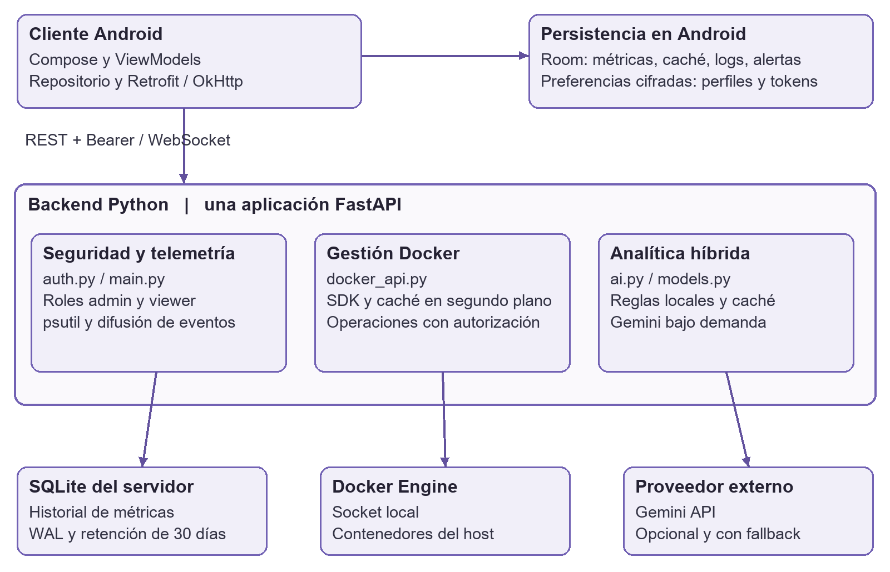
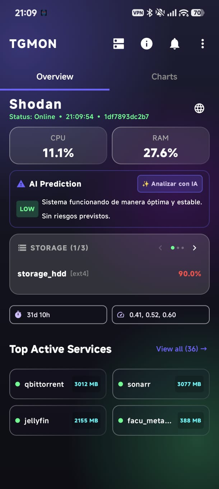
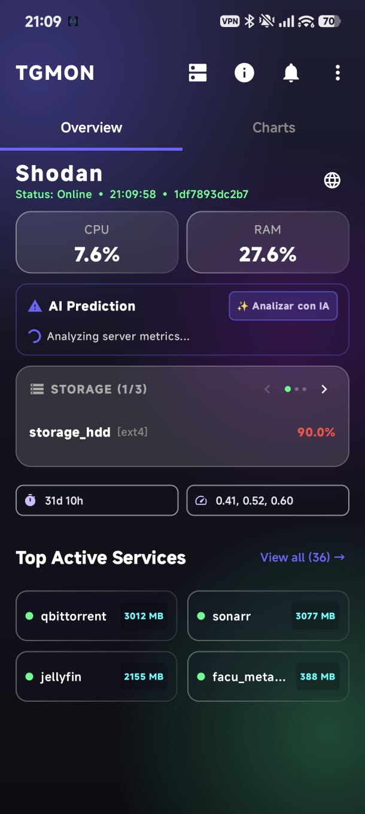
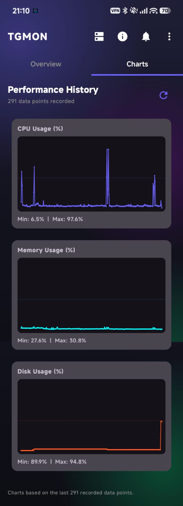
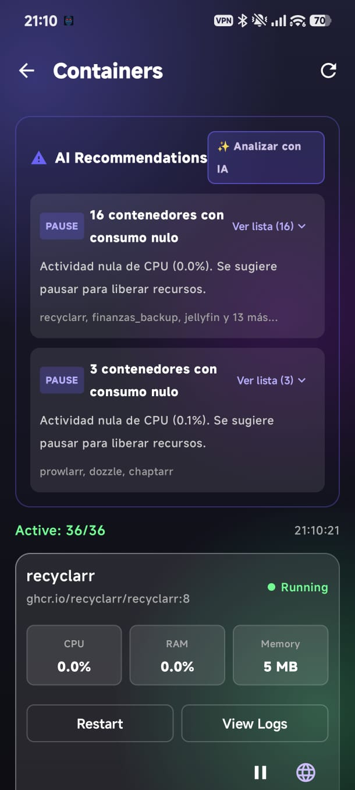
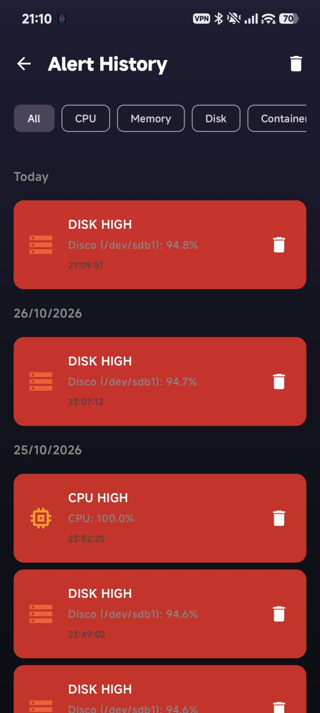

# TGMon v2

Informe del proyecto integrador

UNIVERSIDAD DE LA CIUDAD DE BUENOS AIRES

Trabajo Práctico Integrador
Programación de Vanguardia
Licenciatura en Tecnologías Informáticas

Ciclo lectivo 2026
Docente Ing. Vázquez Alejandro
Fecha de entrega 12 de noviembre de 2026

### Integrantes

Rodrigo Carme
Luis Alberto Quispe
Roberto Carlos Barragán
Gastón Joel Leppen

Versión analizada 1.2.32
Corte de revisión 28 de octubre de 2026
Repositorio https://github.com/Rcarme/UdelaCiudad

TGMon reúne telemetría, historial y administración de contenedores en una aplicación Android. Su analítica combina reglas locales con consultas opcionales a un modelo de lenguaje, manteniendo la decisión operativa bajo control del usuario.

## Resumen ejecutivo

TGMon v2 responde a una necesidad concreta: consultar el estado de una infraestructura con Docker y actuar desde un teléfono cuando no se dispone de una consola de escritorio. El producto integra un cliente Android, una API Python, almacenamiento local y acceso al motor Docker. Las capturas del equipo muestran el servidor Shodan, 36 contenedores activos y registros de uso de CPU, memoria y almacenamiento.

La implementación permite configurar servidores, consultar métricas y series históricas, recibir alertas y ejecutar acciones autorizadas sobre contenedores. Un modo viewer habilita la consulta; el modo admin agrega operaciones de gestión. El diagnóstico local clasifica el riesgo mediante umbrales y variación reciente de CPU. El análisis con Gemini se solicita de forma explícita y dispone de fallback local.

El alcance técnico adoptado cuenta con el visto bueno docente comunicado por el equipo. La arquitectura se describe conforme a su implementación: cliente Android y backend Python modular, con un único proceso de aplicación FastAPI en el despliegue provisto. La separación por módulos organiza las responsabilidades internas.

La contribución del proyecto reside en integrar observación, contexto histórico y acciones operativas en una experiencia móvil. La clasificación heurística apoya el diagnóstico; los gráficos representan observaciones históricas. No se presentan como una serie futura calculada ni como un predictor entrenado y validado estadísticamente.

### Organización del informe

| Sección | Contenido |
| --- | --- |
| 1 a 2 | Problema, alcance y casos de uso |
| 3 a 5 | Arquitectura, datos y decisiones tecnológicas |
| 6 | Analítica híbrida y límites del diagnóstico |
| 7 a 9 | Interfaz final y evidencia visual |
| 10 | Pruebas y estrategia de calidad |
| 11 | Despliegue y operación |
| 12 a 13 | Gestión, evolución y referencias |

## 1 Problema y alcance del proyecto

### Usuarios y contexto

El usuario principal es quien administra un laboratorio, un homelab o una instalación pequeña de servicios en contenedores. Necesita identificar el recurso bajo presión, revisar si un servicio está activo y decidir si debe intervenir. Un segundo perfil, de observación, necesita acceso a las métricas sin permisos para alterar los servicios.

El problema no es la ausencia de herramientas de monitoreo, sino la fragmentación del recorrido operativo: consultar métricas, revisar el historial, interpretar señales y acceder a controles suele requerir alternar entre interfaces. TGMon concentra ese recorrido en Android para el contexto de infraestructura elegido.

### Valor y objetivos

En un laboratorio universitario, la aplicación puede facilitar el seguimiento de servidores usados por estudiantes. En el ámbito laboral, ofrece una vista móvil de apoyo para instalaciones acotadas. Como base de un trabajo final, permite estudiar calidad de telemetría, utilidad de alertas y evaluación de pronósticos sobre series temporales.

El objetivo funcional es observar el estado, contextualizarlo y habilitar una intervención controlada. Los objetivos técnicos son desacoplar la interfaz de la adquisición de métricas, mantener datos consultables ante cortes de conexión, restringir las mutaciones por rol y evitar llamadas continuas al proveedor de IA.

### Alcance implementado

Incluye perfiles de servidores con URL local y remota, autenticación mediante tokens por rol, telemetría de recursos, consulta y control de Docker, historial SQLite/Room, alertas, widget y analítica híbrida. El CRUD de perfiles reside en el dispositivo. No existe un directorio central de usuarios ni un flujo de registro con contraseña.

### Límites del producto

El despliegue provisto corresponde a una instancia de backend por infraestructura. No implementa alta disponibilidad, control multiinquilino ni coordinación de réplicas. Las recomendaciones no deben ejecutar cambios de manera autónoma. El alcance no incluye demostrar precisión predictiva con un conjunto de datos etiquetado ni garantizar ahorro de recursos por pausar un contenedor.

## 2 Casos de uso y recorridos

| Caso | Actor y comportamiento | Resultado esperado |
| --- | --- | --- |
| CU01 Configurar servidor | Admin o viewer registra nombre, URLs y token. | Validación de conectividad y rol; perfil guardado. |
| CU02 Observar recursos | Ambos roles consultan Overview. | CPU, RAM, discos y estado con actualización. |
| CU03 Consultar historial | Ambos roles seleccionan una vista temporal. | Gráficos de observaciones y exportación vía API. |
| CU04 Gestionar Docker | Admin inicia, detiene, reinicia, pausa o reanuda. | La API autoriza y ejecuta sobre el ID validado. |
| CU05 Analizar recursos | Ambos roles consultan diagnóstico local o pulsan Analizar con IA. | Clasificación de riesgo y explicación textual. |
| CU06 Revisar alertas | Usuario consulta registros por tipo y fecha. | Trazabilidad local de eventos y umbrales. |
| CU07 Consultar sin conexión | Usuario abre datos ya almacenados. | Información de caché identificada como tal. |
| CU08 Revocar acceso | Admin invalida o rehabilita tokens. | Bloqueo de nuevas solicitudes autenticadas. |

### Recorrido ante un incidente

El operador observa un indicador elevado, revisa el historial y consulta el detalle del contenedor relacionado. Si el diagnóstico justifica una intervención, confirma la acción y comprueba el nuevo estado. El backend vuelve a validar permisos, aunque el control esté oculto o deshabilitado en la interfaz.

### Excepciones relevantes

Un token inválido produce un error de autenticación; una mutación con rol viewer se rechaza. Si Docker no está disponible, el análisis lo comunica. Si falla el proveedor de IA, se utiliza el resultado heurístico. La caché mejora la continuidad de consulta, pero no acredita que un dato antiguo represente el estado actual.

## 3 Arquitectura implementada

En Android, las pantallas Compose consumen estados de ViewModels. El repositorio coordina llamadas REST y almacenamiento; OkHttp soporta el canal WebSocket. Hilt suministra dependencias y Room persiste información consultable localmente. Las preferencias cifradas guardan los perfiles y credenciales.

En el servidor, main.py administra rutas y tareas de ciclo de vida; auth.py verifica tokens y roles; docker_api.py integra Docker y mantiene la caché; ai.py construye diagnósticos; db.py conserva el historial. El Dockerfile inicia uvicorn main:app desde /app/app. La carpeta server/app es la fuente utilizada por Docker, mientras las pruebas existentes importan módulos desde server.

REST transporta consultas y comandos. El WebSocket recibe autenticación en su primer mensaje y luego distribuye telemetría y eventos. Gemini es una dependencia externa opcional, ajena al circuito básico de observación.

## 4 Comunicación y modelo de datos

### Flujos principales

Telemetría: Android autentica la conexión, el servidor consulta recursos y envía un mensaje type=telemetry con payload. El cliente actualiza el estado visual y guarda muestras. Docker: una acción REST valida rol e identificador, llama al SDK y emite un evento. IA: el cliente solicita /ai/predict-spike o /ai/recommendations; el backend evalúa reglas y, cuando use_llm=true, consulta su caché y eventualmente el proveedor.

| Ruta o canal | Propósito | Acceso |
| --- | --- | --- |
| GET /health y /status | Métricas y estado operativo | Admin / viewer |
| GET /history y /history/csv | Historial con hours entre 1 y 8760 | Admin / viewer |
| GET /ai/predict-spike | Clasificación de riesgo de recursos | Admin / viewer |
| GET /ai/recommendations | Sugerencias sobre contenedores | Admin / viewer |
| GET /docker/containers | Lista y antigüedad de caché | Admin / viewer |
| POST /docker/containers/{id}/{acción} | Control de ciclo de vida | Admin |
| DELETE /docker/containers/{id} | Eliminación de contenedor | Admin |
| WS /ws/telemetry | Telemetría y eventos | Token en primer mensaje |

### Persistencia y cadencias

SQLite del backend conserva timestamp, CPU, memoria y medidas de disco. La tarea de guardado se repite cada 300 segundos más el tiempo de ejecución; la limpieza conserva 30 días. El WebSocket difunde aproximadamente cada 2 segundos y la caché Docker se actualiza en ciclos separados de unos 5 segundos más la adquisición. Son frecuencias distintas, no una única tasa de muestreo.

Room mantiene metric_history, container_cache, container_logs y alert_history en versión 6. El dashboard limita el guardado local a una muestra cada 15 segundos y SnapshotWorker programa trabajo periódico de 15 minutos. La sincronización incorpora el historial del servidor. La identidad de servidor debe incorporarse de forma consistente a métricas y cachés para evitar mezclas al alternar perfiles.

## 5 Decisiones tecnológicas

| Tecnología | Motivo de elección | Costo o límite |
| --- | --- | --- |
| Kotlin y Jetpack Compose | Interfaz nativa declarativa y estados observables. | Acoplamiento al ecosistema Android y atención al ciclo de vida. |
| Hilt y coroutines | Dependencias explícitas y trabajo concurrente organizado. | Mayor complejidad de configuración; respetar cancelación. |
| FastAPI y Pydantic | Rutas HTTP y esquemas de intercambio definidos en Python. | La validación de estructura no sustituye reglas de negocio. |
| psutil y Docker SDK | Acceso a recursos y gestión por API. | Debe validarse qué métricas pertenecen al host o al contenedor. |
| SQLite en el servidor | Persistencia embebida adecuada al volumen local previsto. | Escritura centralizada y copias de seguridad a gestionar. |
| Room en Android | Consultas locales, integración con Flow y migraciones. | Duplicación de datos y sincronización con identidad de servidor. |
| Gemini opcional | Explicación contextual bajo demanda. | Red, cuota, disponibilidad, privacidad y latencia variables. |

### Justificación de la base de datos

El registro periódico por servidor genera unas 288 muestras diarias si el proceso se mantiene activo y el período es de cinco minutos. En 30 días son aproximadamente 8640 filas, sin contar variaciones de cadencia. Para ese orden de magnitud, SQLite permite una implementación simple sin operar otro servicio de base de datos.

El modo WAL permite concurrencia entre lectura y escritura, con sus límites de coordinación y almacenamiento local [R4]. Room aporta una interfaz tipada para la persistencia del dispositivo. Las dos bases cumplen funciones distintas: historial de adquisición en el servidor y continuidad de consulta en el cliente. No constituyen replicación automática ni una transacción distribuida.

### Decisión de evolución

Un motor central como PostgreSQL tendría sentido al incorporar varios agentes, usuarios individuales, consultas consolidadas o mayores demandas concurrentes. Para el alcance actual, el primer paso es mejorar identidad, consistencia y recuperación de los datos, antes de agregar infraestructura.

## 6 Analítica híbrida de recursos

### Reglas implementadas

predict_resource_spikes toma CPU y RAM actuales, consulta una hora de historial y conserva hasta cinco muestras recientes de CPU. Agrega la lectura actual y calcula la diferencia entre el último y el primer valor. Una diferencia de al menos 20 puntos porcentuales indica crecimiento. No divide esa diferencia por el tiempo transcurrido: la variable rate_of_change representa un delta, no una derivada temporal.

| Condición evaluada en orden | Clasificación |
| --- | --- |
| CPU o RAM actual mayor o igual a 85 % | critical |
| Incremento de CPU mayor o igual a 20 puntos | high |
| CPU o RAM actual mayor o igual a 70 % | medium |
| Ninguna de las anteriores | low |

Ejemplo ilustrativo: pasar de 30 % a 55 % de CPU produce un delta de 25 puntos y clasificación high si no se activa antes el nivel critical. Se trata de una advertencia heurística. No establece a qué hora ocurrirá una saturación ni estima una probabilidad calibrada.

### Modelo externo y caché

La llamada externa se activa con use_llm=true. El resultado de recursos se reutiliza durante menos de 120 segundos cuando las diferencias de CPU y RAM son inferiores a 10 puntos. En recomendaciones, la caché compara el número de contenedores. Si la llamada falla o no hay clave disponible, se conserva la respuesta local. La disponibilidad de los identificadores de modelo configurados requiere una comprobación real con el proveedor.

### Recomendaciones y decisión humana

La heurística sugiere pausa para contenedores running con CPU inferior a 0,1 %, salvo ciertas palabras excluidas del nombre. Una lectura baja no demuestra falta de utilidad; puede corresponder a un servicio esperando solicitudes. Docker pause suspende procesos [R2]. La interfaz solicita confirmación y el backend exige rol admin para ejecutar el cambio.

Las mejoras prioritarias son usar ventanas temporales, detectar datos faltantes, validar acciones e IDs devueltos por el modelo y comunicar origen y antigüedad del diagnóstico. No se afirma ahorro de memoria, retención cero del proveedor ni latencia garantizada.

## 7 Interfaz final de monitoreo

Las siguientes figuras son capturas reales aportadas por el equipo el 28 de octubre de 2026. Documentan la interfaz implementada y los estados observados; sus valores corresponden al momento de captura.

### Lectura de la pantalla

La vista concentra identidad del servidor, disponibilidad, recursos, diagnóstico y servicios destacados. El carrusel diferencia discos y la tarjeta de IA ofrece una acción explícita. El estado LOW de la captura corresponde a CPU y RAM; no evalúa el 90 % de disco que aparece en la misma pantalla. Conviene explicitar ese alcance para evitar interpretar LOW como una garantía global de salud.

## 8 Historial y lectura temporal

Figura 4. Historial de rendimiento aportado por el equipo.
La captura muestra 291 observaciones y gráficos separados de CPU, memoria y disco. El rango de CPU visible va de 6,5 % a 97,6 %; memoria, de 27,6 % a 30,8 %; disco, de 89,9 % a 94,8 %.
La separación por recurso permite reconocer picos de CPU y el crecimiento del uso de disco sin confundir escalas. Los mínimos y máximos ayudan a contextualizar la lectura instantánea.
Estas curvas representan datos registrados. El diagnóstico de IA se presenta en otra tarjeta y no añade una trayectoria futura a los gráficos actuales.
Mejoras de usabilidad: fechas visibles en el eje temporal, unidades y zona horaria explícitas, cursor de consulta y diferenciación de lagunas de datos. Para comparar servidores, cada serie debe conservar una identidad inequívoca.

## 9 Contenedores y registro de alertas

La agrupación reduce la repetición de diagnósticos para varios contenedores. Al desplegar la lista, el usuario puede revisar los elementos y confirmar una acción. El historial de alertas aporta contexto posterior al incidente y admite filtros por categoría.

Las capturas también permiten identificar oportunidades: unificar el idioma, mejorar el contraste de textos en alertas rojas y evitar llamar consumo nulo a un valor redondeado de 0,1 %. El estado de carga, la consulta de historial y la confirmación de acciones deben mantenerse accesibles al aumentar el tamaño de fuente.

## 10 Pruebas y estrategia de calidad

### Verificación de esta revisión

Android: se ejecutó gradlew.bat testDebugUnitTest --offline --no-daemon --rerun-tasks. Resultado: BUILD SUCCESSFUL, 48 pruebas JUnit, sin fallos ni errores en los reportes XML. La ejecución incluyó las 33 tareas, sin reutilizar el resultado del test. El tiempo total informado por Gradle fue 1 minuto y 29 segundos.

Backend: 37 pruebas; 0 fallos y 0 errores. Las pruebas se ejecutan sobre una copia aislada de los mismos archivos Python, sin copiar secretos ni bases operativas. Los reportes acompañan el documento. Los mocks verifican contratos y reglas; no prueban por sí solos el despliegue real, Docker operativo o la respuesta de Gemini.

Se comprobó además la sintaxis de los 13 archivos Python versionados y la igualdad de seis pares de módulos duplicados entre server y server/app. Una reproducción aislada de get_disks_data confirmó que la normalización de la ruta raíz Linux puede omitir el disco /. El hallazgo se registra para su corrección, aunque las suites existentes no lo cubran.

### Plan de pruebas complementarias

| Escenario | Criterio de aceptación |
| --- | --- |
| Dos servidores con tokens distintos | Cada destino recibe sólo su token; un 401 no cierra otra sesión. |
| Cambio de servidor y modo offline | Historial y caché sólo del servidor seleccionado. |
| Revocación con WebSocket activo | Cierre del canal y bloqueo de nuevas conexiones. |
| Acción Docker con respuesta perdida | No repetir automáticamente una mutación sin idempotencia. |
| Raíz Linux y varios discos | La raíz aparece y dos discos iguales no se fusionan por capacidad. |
| Gemini lento, inválido o sin cuota | Fallback visible, límite total de tiempo y validación semántica. |
| Migración de Room | Conservación de registros y esquema compatible. |
| Accesibilidad y ciclo de vida | Texto grande legible; volver de segundo plano recupera estado. |

La validación final de integración debe usar contenedores de ensayo y registrar versión, entorno, pasos y resultado. La cobertura numérica y las pruebas de carga no se han medido en esta revisión; tampoco se atribuye precisión estadística al diagnóstico heurístico.

## 11 Despliegue y operación

### Plataforma del proyecto

El despliegue definido usa Docker Compose y una imagen python:3.12-slim. Expone el puerto 8000, monta server/app como código, accede al socket Docker y consulta directorios de almacenamiento del host. La red homelab es externa y debe existir previamente. restart: unless-stopped permite reiniciar el contenedor según la política del motor; no aporta redundancia ni elimina la indisponibilidad durante una actualización.

### Procedimiento reproducible

1. Preparar un host con Docker y Compose y verificar la red homelab. Adaptar COMPOSE_PATH y los volúmenes a rutas existentes.
2. Definir tokens propios en variables de entorno. Configurar GEMINI_API_KEY sólo si se utilizará el proveedor. No usar valores de ejemplo como credenciales operativas.
3. Revisar el Compose efectivo sin publicar sus secretos. Desde server, construir e iniciar con docker compose up -d --build.
4. Verificar /auth/verify, /health, /history y WebSocket con las credenciales de ensayo; comprobar que viewer recibe 403 al mutar.
5. Configurar la aplicación con URL y token correspondientes, comprobar datos y ensayar una acción sobre un contenedor descartable.
6. Registrar versión e identificación de imagen, respaldar datos y ensayar restauración antes de una actualización.

### Condiciones operativas

El acceso al socket Docker requiere tratar el backend como un componente privilegiado. La propuesta de operación es limitar la exposición a una red controlada y usar transporte cifrado. La configuración Android permite HTTP globalmente, por lo que el cifrado no queda garantizado sólo por el manifiesto. Debe verificarse el recorrido efectivo de cada conexión.

Se propone separar el volumen de datos del volumen de código y persistir también el estado de revocación. La base usa metrics.db relativo al directorio de ejecución; con el montaje actual queda junto al código. Una copia consistente debe considerar WAL y validar la restauración. El lock de revocación puede perderse al recrear el contenedor si no se conserva su ubicación.

### Observabilidad del propio monitor

Registrar antigüedad de caché, errores de adquisición, cantidad de clientes, llamadas al proveedor y latencias por percentiles. Las métricas de procesos y red dentro de un contenedor deben contrastarse con el host; no deben atribuirse automáticamente al sistema anfitrión. No se verificó un servidor remoto durante esta revisión.

## 12 Gestión y evidencia de trabajo

El repositorio conserva un historial de integración de frontend y backend, además de minutas y un backlog documentado. El siguiente resumen distingue evidencia de commits de la distribución de funciones registrada por el equipo.

| Integrante | Participación documentada | Evidencia |
| --- | --- | --- |
| Rodrigo Carme | Integración, telemetría, seguridad y operación. | Historial de integración y mejoras en main. |
| Luis Alberto Quispe | Co-diseño inicial y trabajo en pareja con Rodrigo. | Atribución en las minutas y documentación del equipo. |
| Roberto Carlos Barragán | Modelos, lógica y endpoints de analítica Python. | Commit f225281, autor Roberto. |
| Gastón Joel Leppen | Interfaz Android y consumo de endpoints de IA. | Commit 104c08f, autor Gaston Joel. |

### Hitos verificables en Git

| Commit | Cambio registrado |
| --- | --- |
| 170d2d2 | Roles y separación admin / viewer. |
| e122e5b | Soporte de múltiples discos y vista compacta. |
| 104c08f y f225281 | Integración visual Android y módulo Python de IA. |
| f8cde81 | Integración de la rama de backend en main. |
| 6e67dea y 5f4349a | Uso de caché Docker y agrupación visual de recomendaciones. |
| 723d3ba | Invocación de Gemini bajo demanda con caché. |
| 7d70763 | Actualización de integrantes y atribución del trabajo inicial. |

Las minutas del repositorio registran definición de alcance el 15 de septiembre, seguimiento el 24 de octubre e integración entre el 25 y el 28 de octubre. Son registros del equipo; el historial de Git respalda cambios de código, pero no permite verificar por sí mismo asistencia o acuerdos de una reunión.

El backlog incluido en docs/MINUTAS_DE_REUNION.md reúne HU00 a HU07 y responsables. Una tabla reconstruida no equivale a una captura de GitHub Projects, Trello o Jira. Para completar la evidencia de gestión corresponde adjuntar una captura auténtica del tablero y referencias a PRs si se utilizaron. No se representa aquí un tablero ficticio.

## 13 Evaluación técnica y evolución

### Fortalezas

El proyecto integra extremo a extremo una interfaz móvil, telemetría y control de contenedores. Los permisos se validan en el servidor; las preferencias cifradas evitan una degradación silenciosa a texto plano. La caché de Docker evita consultar estadísticas costosas por cada petición. Room y los estados de caché sostienen la consulta ante interrupciones. La IA es opcional y conserva una ruta local de respuesta.

### Mejoras priorizadas

La primera prioridad es asegurar aislamiento entre servidores y revocación efectiva de sesiones activas. También corresponde corregir la raíz Linux y evitar reintentos ciegos de acciones Docker. La segunda prioridad es validar recomendaciones con datos temporales suficientes, representar correctamente la antigüedad de caché y mejorar pruebas sobre las clases de producción. La tercera es consolidar las copias del backend, estabilizar el versionado y reforzar reproducibilidad del despliegue.

Una evolución de la analítica puede incorporar timestamps, horizonte explícito y pronósticos evaluables. Para justificar esa mejora se debe comparar contra una línea base, separar entrenamiento y evaluación temporal y medir error, falsas alarmas y anticipación. Las explicaciones generadas por un LLM complementan esa evaluación; no la reemplazan.

### Referencias

[R1] Cátedra de Programación de Vanguardia. TP Programación de vanguardia 2026 2C. Consigna facilitada por el equipo; entregables en página 4.

[R2] Docker. docker container pause. https://docs.docker.com/reference/cli/docker/container/pause/

[R3] Android Developers. Network security configuration. https://developer.android.com/privacy-and-security/security-config

[R4] SQLite. Write Ahead Logging. https://www.sqlite.org/wal.html

[R5] FastAPI. Deployments Concepts. https://fastapi.tiangolo.com/deployment/concepts/

[R6] Código fuente local. Commit 7d70763f38b118fc0736052084e46ca96552fe4f. Inventario, hashes y reportes XML en evidencias/.

[R7] Equipo TGMon. Cinco capturas de Android facilitadas el 28 de octubre de 2026 y minutas versionadas en docs/MINUTAS_DE_REUNION.md.
